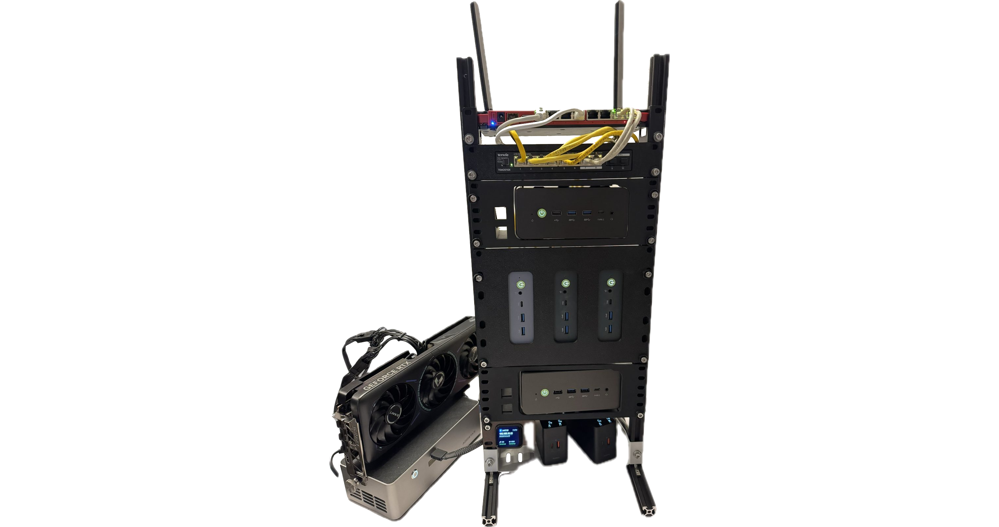

# demo-ai-lab — демонстрационный AI Lab

Публичный стенд **demo-ai-lab.ru**: локальный LLM-инференс, RAG, транскрибация, OCR и агенты
на Kubernetes из пяти мини-ПК. Правило одно: **что можно обработать локально — обрабатывается
локально**, наружу уходит только то, что не представляет ценности.

## Семь кейсов — порядок и есть сценарий

Номер = очередь на сцене. Сценарий, блокеры и фолбэк — в файле кейса; наборы моделей,
переключения и готовность — `cases/README.md`.

| # | Кейс | Тезис | Что на карте |
|---|---|---|---|
| 01 | [27B на одной карте](cases/01-27b-one-card.md) | 128K контекста в 16 ГБ — но только эксклюзивно | `Qwen3.8-27B-UD` |
| 02 | [Прокси во внешнюю модель](cases/02-proxy-dlp-guard.md) | наружу — только под DLP, стражем и квотой | страж `4B` |
| 03 | [Транскрибация](cases/03-asr-speakr.md) | запись не покидает стенд, наружу уходит текст | страж `0.6B` + `whisper-turbo` |
| 04 | [OCR на своём железе](cases/04-ocr-gpu.md) | бумага — то, что нельзя отдавать | `GLM-OCR` |
| 05 | [RAG: поиск локально](cases/05-rag-embeddings-local.md) | дорог не ответ, а поиск | страж `4B`; `bge-m3` на 780M |
| 06 | [Агенты в песочнице](cases/06-agents-sandbox.md) | агент исполняет чужой текст — значит, политика, а не доверие | страж `4B` |
| 07 | [Картинка на своей карте](cases/07-image-gen.md) | и картинку не отдаём в облако | `Z-Image-Turbo` |

Готовится **08 (черновик)**: [«Озвучка с клоном голоса» (TTS)](architecture/specs/tts-voice-clone-draft.md) —
в `cases/` не добавлен, номер не закреплён.

**Цена одной карты** — сквозная механика. Страж `Qwen3Guard-Gen-4B` с `util 0.80` занимает
≈12.7 из 15.93 GiB, поэтому внешний маршрут и локальная модель на карте не живут вместе; отсюда
пять переключений `Stop/Start` в GPUStack (`Model Service → Deployments`), `gemma-4-12B` — резерв,
а не участник. Без стража внешний маршрут отдаёт `503 guard unavailable (fail-closed)`.

Готовы 01, 02, 03 и 07; 04–06 доводятся — что именно, в `cases/README.md` («Готовность кейсов»).
К показу стенд развёрнут целиком: на сцене ничего не устанавливается, человек только переключает
модели и говорит.

## Стенд



Пять мини-ПК `k8s-01…05` в открытой алюминиевой раме, роутер, коммутатор `Tenda TEM2010X`,
GPU на выносном подключении — ноябрь 2026, [HARDWARE](HARDWARE.md)

| Что | Как |
|---|---|
| Кластер | kubeadm 1.35, Cilium; 3 control-plane, GPU-нода `k8s-04`, компьют `k8s-05`; Longhorn (`replica=2`) |
| Инференс | GPUStack 2.2.3 на RTX 5070 Ti 16 ГБ, OpenAI-совместимый `api.`; модели — hostPath |
| Вход | Higress, пара k8s-02/03, VIP `.230`; снаружи — Cloudflare Tunnel, TLS Full strict |
| Наружу | `llm-svc.`: JWT → DLP → страж → DeepSeek → лимиты токенов |
| Сервисы | `owu.` чат, `rag.` RAGFlow, `doc.` Docling+MCP, `spk.` транскрибация, `ysrch.` поиск, `mcp.` каталог, `hm.`/`dsh.` агенты |
| SSO | Keycloak `auth.` — все сервисы, кроме OSS-сборки RAGFlow |

Детали — `architecture/ARCHITECTURE.md` (§3–6); что стоит — [HARDWARE.md](HARDWARE.md) и [SOFTWARE.md](SOFTWARE.md);
решения и их причины — `adr/`.

## Подключение: Wi-Fi и hosts

**Wi-Fi для зала:** сеть **`7llm-cases-hl++`**, пароль **`avrora6539`** (WPA2/WPA3-PSK, 2.4 ГГц).
Пароль публикуется осознанно: это гостевой доступ на время показа, после мероприятия меняется.

В сети стенда имена резолвит роутер (split-DNS на ingress-VIP `.230`) — настраивать ничего не нужно.
Если вы в другой сети или ваш DNS перехватывает запросы, направьте имена на стенд вручную
(`/etc/hosts` на Linux/macOS, `C:\Windows\System32\drivers\etc\hosts` на Windows):

```hosts
# адрес — ingress-VIP стенда в его LAN (.230); в другой сети адрес стенда другой, и в
# репозиторий он не попадает (HYGIENE.md: внешние адреса не публикуем)
192.168.10.230 demo-ai-lab.ru owu.demo-ai-lab.ru rag.demo-ai-lab.ru doc.demo-ai-lab.ru spk.demo-ai-lab.ru
192.168.10.230 api.demo-ai-lab.ru auth.demo-ai-lab.ru llm.demo-ai-lab.ru llm-svc.demo-ai-lab.ru mcp.demo-ai-lab.ru
192.168.10.230 echo.demo-ai-lab.ru ysrch.demo-ai-lab.ru hm.demo-ai-lab.ru dsh.demo-ai-lab.ru argo.demo-ai-lab.ru hgc.demo-ai-lab.ru mon.demo-ai-lab.ru

# IPv6 гасим: иначе клиент возьмёт A из hosts, а AAAA из публичного DNS и уйдёт мимо стенда
:: demo-ai-lab.ru owu.demo-ai-lab.ru rag.demo-ai-lab.ru doc.demo-ai-lab.ru spk.demo-ai-lab.ru
:: api.demo-ai-lab.ru auth.demo-ai-lab.ru llm.demo-ai-lab.ru llm-svc.demo-ai-lab.ru mcp.demo-ai-lab.ru
:: echo.demo-ai-lab.ru ysrch.demo-ai-lab.ru hm.demo-ai-lab.ru dsh.demo-ai-lab.ru argo.demo-ai-lab.ru hgc.demo-ai-lab.ru mon.demo-ai-lab.ru
```

`::` — не адрес стенда, а подавление AAAA: клиент остаётся на IPv4 из hosts. На macOS после правки —
`sudo dscacheutil -flushcache; sudo killall -HUP mDNSResponder`. Проверка:
`curl -sI https://owu.demo-ai-lab.ru` → `200` (сертификат wildcard, имя совпадает).

## Куда смотреть

| Нужно | Открыть |
|---|---|
| Программа показа: кейсы, модели, переключения | `cases/README.md` |
| Архитектура, размещение, статус (§7 — единственный источник) | `architecture/ARCHITECTURE.md` |
| Каталог доков и диаграммы C1/C2 | `architecture/README.md` |
| Спеки сервисов, установки, внешнего доступа | `architecture/specs/` |
| Адреса сервисов и кто за SSO | `architecture/endpoints.md` |
| Железо: состав, мощность, стоимость | [HARDWARE.md](HARDWARE.md) — рядом журнал дисков и износа (`architecture/hardware-inventory.md`) |
| ПО: классы, версии, назначение | [SOFTWARE.md](SOFTWARE.md) — прикладной софт, агенты, системный слой, devops |
| Сеть и шлюз | `network/README.md` |
| Установка и восстановление | `ansible/README.md`, `references/health-runbook.md` |
| Деплой приложений | `gitops/README.md` |
| Здоровье стенда | `python3 scripts/k8s_health.py --brief`, обвязка — `scripts/env_health.py` |
| 27B без кластера, на одной карте | `host-beellama/README.md` |
| Правила репозитория и публикации | `AGENTS.md`, `HYGIENE.md` |

Репозиторий публичный: секреты, MAC-адреса и адреса uplink в него не попадают (`HYGIENE.md`).
