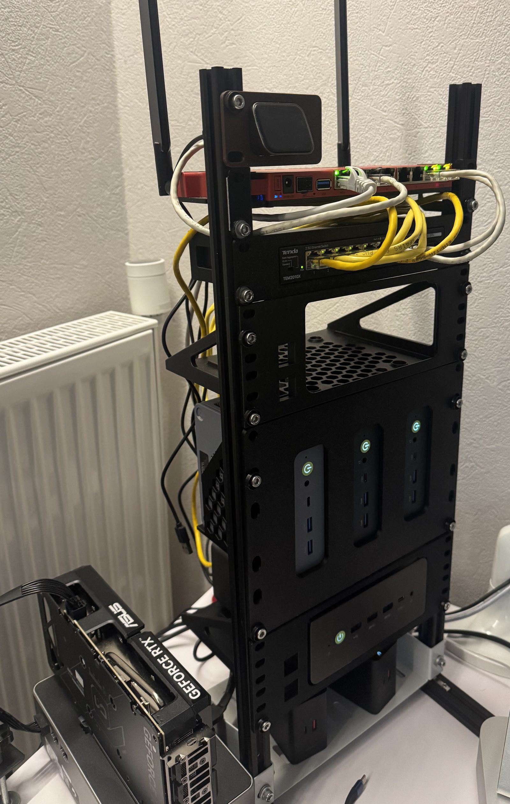

# demo-ai-lab — демонстрационный AI Lab

Публичный стенд **demo-ai-lab.ru**: on-prem LLM-инференс, RAG, транскрибация и ИИ-агенты
на собственном Kubernetes-кластере из пяти мини-ПК. Принцип утилитарности:
**локальная обработка предпочтительна** — наружу уходит только то, что не представляет ценности.

## Стенд

Мини-ПК кластера `k8s-01…05`, роутер и L2-коммутатор, GPU-карта инференса на выносном
подключении — одна открытая стойка, ноябрь 2026. Состав узлов и размещение сервисов —
`architecture/ARCHITECTURE.md` §2.3, §5.

## Стратегия выступления — семь кейсов на одной карте

Порядок, наборы моделей и переключения — `cases/README.md`; сценарий, блокеры и фолбэк — в файле кейса.
Номер файла = очередь на сцене. Модели переключает человек в web-интерфейсе GPUStack
(`Model Service → Deployments → Stop/Start`) — скриптов и `kubectl scale` нет намеренно.

| # | Кейс | Тезис для зала | На GPU (5070 Ti / 780M) |
|---|---|---|---|
| 01 | [27B на одной карте](cases/01-27b-one-card.md) | 128K контекста в 16 ГБ — но только эксклюзивно | `Qwen3.8-27B-UD` (BeeLlama) |
| 02 | [Прокси во внешнюю модель](cases/02-proxy-dlp-guard.md) | локальные модели — не религия; наружу — только под DLP, стражем и квотой | страж `4B` |
| 03 | [Транскрибация](cases/03-asr-speakr.md) | запись не покидает стенд, наружу уходит только текст | страж `0.6B` + `whisper-turbo` |
| 04 | [OCR на своём железе](cases/04-ocr-gpu.md) | бумага — самый частый вид «данных, которые нельзя отдавать» | `GLM-OCR` |
| 05 | [RAG: поиск локально](cases/05-rag-embeddings-local.md) | дорогая часть RAG — не генерация, а поиск; наружу — только отобранный контекст | страж `4B`; `bge-m3` + реранк на 780M |
| 06 | [Агенты в песочнице](cases/06-agents-sandbox.md) | агент исполняет чужой текст — значит, ограничен политикой, а не доверием | страж `4B` |
| 07 | [Картинка на своей карте](cases/07-image-gen.md) | картинка — самый очевидный кандидат «отдать в облако»; и всё равно не отдаём | `Z-Image-Turbo` (vLLM-Omni), эксклюзивно |

**Цена одной карты — сквозная механика.** Страж `Qwen3Guard-Gen-4B` с `util 0.80` занимает ≈12.7 из
15.93 GiB, поэтому внешний маршрут и локальная модель (`gemma`/27B) на одной карте не живут вместе.
Отсюда пять физических переключений (01→02→03→04→05; 05→06 без переключения; 06→07 — закрывающий кейс,
после которого карта уже не нужна) и `gemma-4-12B` в роли
резерва, а не участника. Страж — единый внешний ID `Qwen3Guard-Gen-4B`: в кейсах 02/05/06 исполняет `4B`,
в 03 (рядом с ASR) — `0.6B`; плагин и клиенты при смене версии не меняются. Без поднятого стража внешний
маршрут отдаёт `503 guard unavailable (fail-closed)` — это и есть предохранитель кейса 02.

**Подготовка до сцены.** 01, 02, 03 и 07 работают (07 — `Z-Image-Turbo` через vLLM-Omni с квантом fp8:
3–4 с на кадр 512×512 при 8 шагах, пик 15.3 GiB, подтверждено 2026-11-04); до показа доводятся 04 (`GLM-OCR`
в каталог), 05 (RAGFlow + `bge-m3`/реранк на 780M) и 06 (рантаймы `qm`/`her`, песочница). На сцене этих
работ нет: стенд выходит готовым, человек только переключает модели. Детали — `cases/README.md`,
«Готовность кейсов».

**Правила сцены.** Зал заходит по Wi-Fi на LAN-адреса (`.230`); `doc.`/`ysrch.` — публичные
демо-маршруты (режим доступа — локальный отчёт ИБ);
демо-учётки Keycloak — пул `demo01…` (иначе квоты и access-лог не различить); любой кейс с внешней
моделью (02, 03, 05, 06) требует поднятого стража.

## Четыре части лаборатории

| # | Часть | Что входит | Кейсы |
|---|---|---|---|
| 1 | Инфраструктура и инференс | кластер из пяти мини-ПК (control-plane ×3, GPU-нода 04, компьют-нода 05), Cilium, Longhorn, Higress; GPUStack 2.2.3 на RTX 5070 Ti, vLLM-раннеры, модели; OpenAI-совместимый API `api.` | 01 и модели/страж для остальных |
| 2 | Прикладные сервисы | Open WebUI (`owu.`), RAGFlow (`rag.`), Docling + MCP (`doc.`), Speakr (`spk.`), Yandex Search MCP (`ysrch.`), каталог MCP (`mcp.`) | 03, 04, 05, 06 |
| 3 | Безопасный выход наружу | `llm-svc.`: `key-auth` → DLP `ai-data-masking` → страж Qwen3Guard (fail-closed) → `ai-proxy` (DeepSeek) → лимиты; SSO-путь `llm.` на паузе | 02, 03 (саммари), 05, 06 |
| 4 | Агентский режим | рантаймы `qm.`/`her.`, MCP-инструменты из каталога, песочница (namespace + квоты + NetworkPolicy) | 06 |

Детали каждой части — спеки в `architecture/specs/`; сценарии — `cases/`.

## Исходная точка демо

К началу выступления — после подготовки из раздела выше — стенд **развёрнут целиком**: инфраструктура,
сервисы, модели, каталог MCP и индекс RAG-базы. На сцене ничего не устанавливается и не настраивается —
единственное действие человека: **переключение моделей** в UI GPUStack
(`Model Service → Deployments → Stop/Start`) под набор текущего кейса; сетка переключений — `cases/README.md`.

| Слой | Что стоит | Где зафиксировано |
|---|---|---|
| Железо | 5× GMKtec (Ubuntu 24.04): containerd, swap off; NVMe 477G (у k8s-05 — 1 TB), LV Longhorn 250G на 02/03/04 (k8s-01 и k8s-05 вне пула) | `architecture/ARCHITECTURE.md` §2.3, ADR-0002 |
| Кластер | kubeadm 1.35, CNI Cilium; роли (ADR-0003): **k8s-01/02/03 — control-plane ×3** (компьют на 01, GitOps на 02, **ingress — пара 02/03 на VIP `.230`**, лёгкие сервисы на 03), k8s-04 — инференс **и** data-heavy сервисы (без taint'а; nodeSelector + priorityClass); metrics-server | `architecture/ARCHITECTURE.md` §5, ADR-0003 |
| Хранилище | **Longhorn**: default StorageClass, replica=2, анти-аффинити; данные сервисов — PVC, модели — hostPath на k8s-04 | ADR-0002, ADR-0003 |
| Ingress | **Higress** — единственный контроллер на паре k8s-02/03, ingress-VIP `.230`; внешний путь — Cloudflare Tunnel | ADR-0001, спека F7/F8 |
| Сеть | MikroTik `gw-demo-ai-lab`, LAN `192.168.10.0/24`, LAG до коммутатора, Wi-Fi для аудитории | `network-map-detail.md`, `mikrotik-setup.md` |
| Доступ | снаружи — Cloudflare Tunnel, TLS Full strict (edge + origin LE wildcard); из LAN — split-DNS на `.230`, тот же https; SSO — Keycloak (`auth.`); наружу — демо-сервисы и админки (Argo CD, консоль Higress), Longhorn — только LAN | `architecture/ARCHITECTURE.md` §6, ADR-0004, external-access E8/E9 |
| Смоук-маршрут | `echo.demo-ai-lab.ru` — постоянный тестовый контейнер: проверка LAN- и внешнего пути в любой момент | спека F8, external-access E5 |
| Подготовка сцены | образы в CRI нод, веса на k8s-04, индекс RAG-базы собран заранее; состав моделей по кейсам — `cases/README.md` | — |

## Документация

| Файл | Что это |
|---|---|
| `architecture/README.md` | обзор каталога: рендеры диаграмм (C1, C2, полная схема) + индекс спек |
| `architecture/ARCHITECTURE.md` | архитектура C2, размещение сервисов по узлам, статус строительства (§7) |
| `architecture/specs/` | спецификации: установка кластера, внешний доступ, SSO и сервисы частей 1–4 (по файлу на сервис, буквы фаз F/E/K/G/O/S/D/Y/M/P/H/Q) |
| `architecture/specs/k8s-install-spec.md` | спека установки кластера: kubeadm → Cilium → Longhorn → NFD → cert-manager → Argo CD → ingress-VIP `.230` + Higress (F0–F10) — грабли и приёмка каждой фазы |
| `architecture/specs/external-access-spec.md` | внешний доступ: Cloudflare Tunnel, split-DNS, TLS Full strict; приёмка E1–E5, E7 (второй egress — коннектор на внешней VM + SSH-hop); E6 снят 2026-10-24: служебные — только LAN |
| `architecture/specs/keycloak-spec.md` | SSO: Keycloak 26.8.1 ×2 + PostgreSQL 17.11 на паре k8s-02/03 через Argo CD, `auth.demo-ai-lab.ru`, realm `dev`, пользователи `user-test`/`admin-test`; приёмка K1–K7 (креды — в `*.local.md`, не в git) |
| `architecture/endpoints.md` | все публичные адреса сервисов короткими именами (`owu`, `rag`, `doc`, `spk`, `ysrch`, `mcp`, `qm`, `her`, `api`, `auth`, `llm`, `llm-svc`, `argo`, `hgc`) + кто за SSO |
| `architecture/specs/mcp-registry-spec.md` | каталог MCP-серверов (`mcp.demo-ai-lab.ru`): MCP Registry **1.8.6** + PostgreSQL 16 на паре k8s-02/03, **встроенная витрина на `/`**, публикация через доменную проверку, приёмка M1–M8 (спека v2.0) |
| [skills-demo-ai-lab](https://github.com/msklv/skills-demo-ai-lab) | каталог агентских скиллов (формат SKILL.md) — **отдельный публичный репозиторий**, не установка в кластере: 18 скиллов Apache-2.0 (импорт `anthropics/skills` по пину), установка копированием каталога в скиллы агента; решение — `adr/adr-0010-skills-collection-git-repo.md` |
| `architecture/specs/gpustack-spec.md` | GPUStack 2.2.3 (часть 1): helm-чарт, GPU-воркер на k8s-04, раннер vLLM, модели AWQ, `api.demo-ai-lab.ru`; приёмка G0–G8 (креды — `gpustack-admin.local.md`, не в git) |
| `architecture/specs/owu-spec.md` | Open WebUI (`owu.demo-ai-lab.ru`): чарт 17.0.0/образ 0.12.0, OIDC через Keycloak, ключ GPUStack, пробы/ресурсы; приёмка O1–O6 |
| `architecture/specs/spk-spec.md` | Speakr (`spk.demo-ai-lab.ru`): plain-манифесты, образ `0.10.18-alpha-lite`, ASR через GPUStack `openai_whisper`, саммари через `llm-svc.`, SSO; приёмка S1–S6 |
| `architecture/specs/doc-spec.md` | Docling Serve + **MCP** (`doc.demo-ai-lab.ru`, MCP на `/mcp`): образ `-cpu` v1.38.2, OCR на CPU с русским (`eslav`/`rus`), второй контейнер `docling-mcp` в `remote`-режиме, кэш моделей Job-хуком; приёмка D1–D6 |
| `architecture/specs/ysearch-spec.md` | Yandex Search MCP (`ysrch.demo-ai-lab.ru`): форк `msklv/yandex-search-mcp-server` v1.3.1, StreamableHTTP `/mcp`, TCP-пробы, ConfigMap против `421 Invalid host`, ключ Search API в Secret; приёмка Y1–Y5 |
| `architecture/specs/firecrawl-spec.md` | Firecrawl self-host (`fc`, шаг 2+): «URL → markdown» для потребителей без браузера — api `2.10.19-production` + `playwright-service` + RabbitMQ + nuq-postgres + Redis, пины по amd64-дигестам, **ClusterIP-only** (без Ingress), guard приватных адресов включён; приёмка C1–C6, **развёрнут 2026-11-10 на k8s-05** (5 подов, ClusterIP-only, Ingress и MCP-обёртка — фаза C6) |
| `architecture/specs/llm-proxy-spec.md` | проксирование LLM наружу (`llm-svc.` / `llm.`, ADR-0008): JWT Keycloak realm `dev` (`client_credentials`), `jwt-auth` (inline JWKS) + `opa` по `aud`/роли, `ai-proxy` `provider.type: deepseek`, `ai-data-masking` + `ai-qwen-guard` (fail-closed), `ai-token-ratelimit`; приёмка P1–P6, **с 2026-11-02 в работе только `llm-svc.`** (SSO-путь `llm.` на паузе, ревизия ADR-0008), не снят P4-стрим |
| `architecture/specs/health-check-spec.md` | проверка здоровья и готовности стенда пятью слоями: кластер/обвязка → образы → модели → прерогативы фичи → маршруты и доки; формат ответа владельцу |
| `architecture/specs/hermes-spec.md` | Hermes Agent (`hm.demo-ai-lab.ru`, шаг 4): образ `v0.23.0` пин по digest, панель за SSO Keycloak (**публичный PKCE-клиент** — confidential не поддерживается), MCP стенда (`doc.`, `ysrch.`), основная модель `deepseek-flash` через `llm-svc.` + локальная `Qwen3.8-27B-UD` через `api.`; обвязка (Chromium в образе, Playwright не нужен), PVC, egress; приёмка H1–H9, **развёрнут 2026-11-06** (ns `her`, k8s-04) |
| `architecture/specs/qm-spec.md` | qm — мультиагентный рантайм (`qm.demo-ai-lab.ru`, шаг 4): форк-образы `v0.1.17-ai-lab` по дигайлу (core 243 MiB, egress-proxy, sandbox-base), всё в одном `core` (порты 8080/8000), свой PostgreSQL + **pgvector** ради памяти, SSO Keycloak (клиент `qm`, `/auth/callback`), org **`demo-lab`**, две модели custom-provider'ами (`Qwen3.8-27B-UD` через `api.`, `deepseek-flash` через `llm-svc.`), три MCP по in-cluster DNS, эмбеддинг `bge-m3` (1024); разбор режима песочниц (4 варианта + рекомендация) и фазы Q1–Q9, **спека, не установлено** |
| `architecture/equipment.md` | **публичный список оборудования стенда**: 5 мини-ПК GMKtec, GPU MAXSUN RTX 5070 Ti в док-станции AOOSTAR AG01S (OCuLink, Huntkey 800 W), роутер MikroTik L009UiGS-2HaxD, коммутатор Tenda TEM2010X, Baseus 240 W GaN, консоль и JetKVM |
| `architecture/hardware-inventory.md` | инвентарь железа: диски и износ (SMART), прошивки, TBW — снимки по датам |
| `network-map-detail.md` | живая карта сети стенда |
| `mikrotik-setup.md` | рецепт настройки MikroTik (для повторения стенда) |
| `adr/` | реестр ключевых архитектурных решений 0001–0010: Higress — единственный ingress (0001), дисковая модель (0002), три control-plane (0003), внешний доступ + VM-egress (0004), MCP-реестр (0005), guardrail (0006), модели и бюджет VRAM (0007), внешний LLM (0008) |
| `references/` | операционные runbook'и: health-runbook (слой 1 вручную + восстановление), storage-model, gpu-scheduling-options, service-spec-authoring, keycloak-sso |
| `beellama-rtx5060/` | справочник хостового прогона BeeLlama на RTX 16 ГБ (рецептура 5060 Ti, действующие замеры — 5070 Ti, SPEC custom backend) — каталог не читать без явного запроса (AGENTS.md) |
| `old/` | архив выведенных материалов (storytelling, старые HTML) — не читать без явного запроса (AGENTS.md) |
| `presentations/` | Колоды и ассеты докладов: `internal-demo-2026-11/` — внутреннее демо стенда на Slidev (стенд → кейсы → задания), `highload-2026/` — тезисы и шаблон HighLoad++ 2026; стиль — `presentations/gnivc-compact-design-system.md` |
| `cases/README.md` + `cases/01…07` | **программа выступления**: семь кейсов в порядке показа, наборы моделей и бюджет VRAM, переключения, готовность и правила сцены; сценарий, блокеры и фолбэк — по файлу на кейс |
| `IDEAS.md` | принцип стенда + реестр идей для реализации (1–2 предложения на идею) |
| `AGENTS.md` | правила работы с репозиторием (что публикуем, что нет) |

### Операционное

| Что | Где | Зачем |
|---|---|---|
| Проверка кластера | `scripts/k8s_health.py` (`--brief`, `--json`) | один прогон: API/VIP, ноды и pressure, поды, etcd, control-plane/kube-vip, Argo/Longhorn/Higress, SSH-замер, origin в LAN (`scripts/README.md`) |
| Проверка обвязки | `scripts/env_health.py` (`--brief`, `--json`, `--no-vm`, `--no-check-host`) | внешняя VM-egress (cloudflared/haproxy/hop-и), Cloudflare-туннель через API, внешний путь с подтверждением check-host (`scripts/README.md`) |
| Статистика внешнего маршрута | `scripts/llm_stats.py` (`--tail`, `--since`, `--host`, `--json`, `--events-only`) | access-лог `ai_log` по всем подам шлюза: consumer, модель, токены, коды, цена защиты — разбор в `cases/02-proxy-dlp-guard.md` |
| Здоровье и разбор | `architecture/specs/health-check-spec.md` + `references/health-runbook.md` | слои готовности (что проверить руками) и ручной разбор не-зелёного/восстановление; контракт скриптов — `scripts/README.md` |
| Подготовка нод и кластера | `ansible/` — `site-cluster.yml`, `site-gpu.yml`, `pb-*.yaml`, `values-*.yaml` | детерминированная установка: containerd, p2p, kubeadm-пакеты, два kube-vip (`.240` API / `.230` ingress), GPU-драйвер (`ansible/README.md`) |
| GitOps | `gitops/` — app-of-apps + ApplicationSet | деплой = git push, статус по живым подам (`gitops/README.md`) |

Текущее состояние стенда — `architecture/ARCHITECTURE.md` §7 (единственный источник статуса:
что закрыто, что открыто); программа показа — `cases/README.md`; живая проверка —
`python3 scripts/k8s_health.py`. Репозиторий публичный; публикуются только нечувствительные данные
(секреты, MAC-адреса и адреса uplink — вне репозитория).
