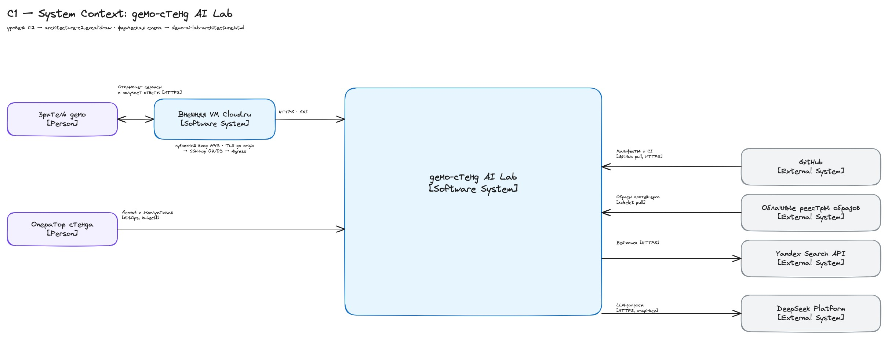
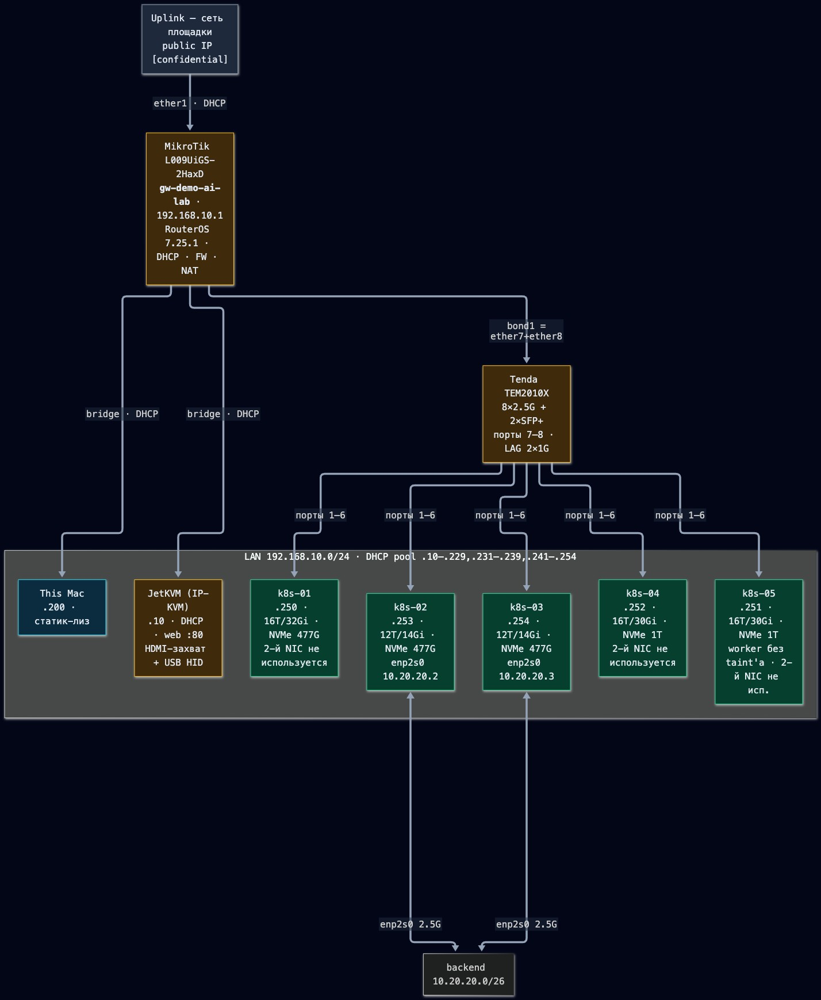
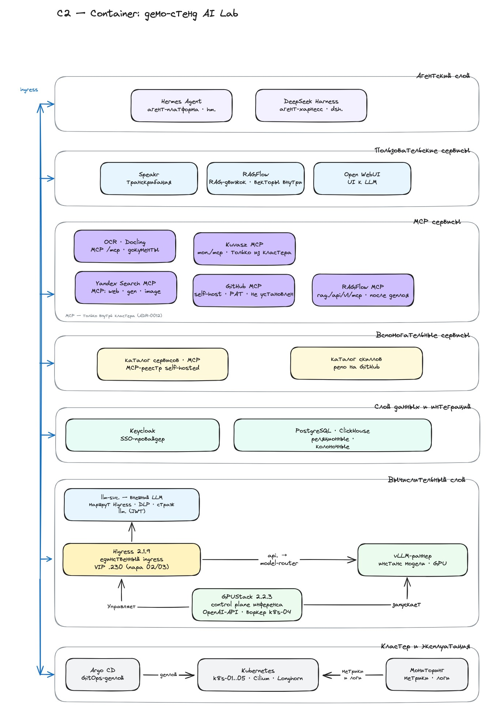

# demo-ai-lab — Архитектура стенда

> Демонстрационный AI Lab: ИИ-агенты и on-prem LLM-инференс.
> Сеть — `network/map.md`; диаграммы и индекс спек — `architecture/README.md`;
> текущее состояние — §7 этого файла; доступы — `inventory.local.md` (не публикуется).

## 1. Концепция

- Публичное имя лаборатории — **`demo-ai-lab.ru`** (разглашение и публикация допустимы).
- Закрытая демо-сеть (LAN `192.168.10.0/24`) на 5 узлах GMKtec (Ubuntu 24.04.4)
  + шлюз MikroTik + Mac-консоль.
- Целевое состояние — «контейнер C2»: Kubernetes-кластер с LLM-инференсом,
  агентами, RAG, транскрибацией и observability.
- Задача: демо работы ИИ-агентов и on-prem вычислений; локальная обработка предпочтительна,
  наружу передаётся только то, что не представляет ценности.

C1 — контекст: зритель и оператор, публичный вход через внешнюю VM (`haproxy :443`, TLS passthrough
→ SSH-hop'ы), внешние системы — GitHub, реестры образов, Yandex Search API, DeepSeek.
Исходник — `architecture-c1.excalidraw`.

Полная схема (физический + логический слой) — [`demo-ai-lab-architecture.html`](demo-ai-lab-architecture.html)
в браузере, рендер — `demo-ai-lab-architecture.jpg`.

## 2. Физический слой (проверено живым аудитом)

Источник — mermaid в `network/map.md`; рендер — `python3 scripts/render_diagrams.py network`
(→ `network/map.jpg`). Рецепт шлюза — `network/mikrotik.md`.

### 2.1 Сегменты

| Сегмент | Назначение | Детали |
|---|---|---|
| Uplink (сеть площадки) | сеть за шлюзом, выдаётся площадкой конференции | её адреса не публикуются |
| `192.168.10.0/24` | LAN (демо-сеть) | шлюз `192.168.10.1`; DHCP pool `.10–.229,.231–.239,.241–.254` (`.240` API-VIP, `.230` ingress-VIP — выведены из пула); Wi-Fi (2.4GHz-n) + bridge; split-DNS: `demo-ai-lab.ru` + regexp-wildcard → `.230` (`network/mikrotik.md`) |
| `10.20.20.0/26` | Backend p2p | k8s-02 `.2` ↔ k8s-03 `.3`, 2.5G, MTU 1500; L2 проверен (2026-10-12); netplan восстановлен 2026-10-18 (`ansible/pb-net-p2p.yaml`, приёмочный взаимный ping) |

### 2.2 Шлюз

- **MikroTik L009UiGS-2HaxD** (identity `gw-demo-ai-lab`), RouterOS **7.25.1** (с 2026-11-19;
  RouterBOARD firmware 7.24.5).
- LAN: `bridge` → `192.168.10.1/24`; WAN: `ether1` = uplink площадки (адреса не публикуются).
- **Link aggregation до коммутатора**: `bond1` = ether7+ether8 (mode `balance-xor`), порт бриджа —
  подключён к Tenda **TEM2010X** (8 × 2.5 Гбит/с + 2 × SFP+; L2, статическая агрегация портов 7–8,
  без LACP); ноды — на портах 1–6 Tenda.
  Проверено 2026-10-12: все три ноды пингуются через bond (роутер и Mac), оба линка 1G, 0 ошибок.
- Маршрут: default через шлюз площадки; NAT: masquerade на WAN (LAN → интернет).
- Firewall: защита WAN (input drop из не-LAN, drop invalid, fasttrack),
  изоляция стенда: forward drop LAN → uplink-сеть (другие стенды недоступны с LAN, интернет работает).
  mDNS в bridge разрешён.
- Управление: Winbox (8291) / REST (8080, основной канал) / API (8728) / SSH (22, запасной, разовые команды), вход `admin`;
  Изменения — владельцем через UI, не API (правило).

### 2.3 Узлы (GMKtec, Ubuntu 24.04.4)

Состав, CPU/RAM/диски и цены — `HARDWARE.md`; разметка дисков — `references/storage-model.md`;
SMART и прошивки — `hardware-inventory.md`.

| Узел | LAN IP (DHCP) | 2-й интерфейс | Роль |
|---|---|---|---|
| `k8s-01` | 192.168.10.250 | `enp3s0` — не используется (down) | control-plane #1 + компьют-heavy (ADR-0003) |
| `k8s-02` | 192.168.10.253¹ | `enp2s0` — p2p `10.20.20.2` | control-plane #2, ingress-пара (VIP `.230`), GitOps, `vmhop` |
| `k8s-03` | 192.168.10.254¹ | `enp2s0` — p2p `10.20.20.3` | control-plane #3, ingress-пара (VIP `.230`), `vmhop`, лёгкие сервисы |
| `k8s-04` | 192.168.10.252 | `enp3s0` — не используется | worker: инференс GPUStack + data-heavy |
| `k8s-05` | 192.168.10.251 | `enp2s0` — не используется (down) | worker без taint'а; в пуле Longhorn с 14.11 |
| This Mac | 192.168.10.200 (статик-лиз) | — | консоль: ssh, kubectl, диаграммы |

_¹ Резервации 02/03 после переустановки не срабатывали (client-id/DUID), восстановлены 17.10._

## 3. Логический слой — целевое состояние (контейнер C2)

Контейнер C2 = Kubernetes на k8s-01…05 + ingress.

C2 — целевой контейнер: агентский слой, пользовательские сервисы, MCP, данные, вычисления,
кластер и эксплуатация. Исходник — `architecture-c2.excalidraw`.

Слои:

| Слой | Компоненты | Назначение |
|---|---|---|
| Агентский | **Hermes Agent** (`hm.`, агент-платформа) и **DeepSeek Harness** (`dsh.`, агент-харнесс, [deepseek-ai/deepseek-harness](https://github.com/deepseek-ai/deepseek-harness)); оба за SSO (ADR-0012) | автономный цикл: код, инструменты, скиллы |
| Пользовательские сервисы | Speakr, RAGFlow, Open WebUI | транскрибация, RAG, UI к LLM |
| MCP-сервисы | **OCR · Docling MCP** (`/mcp`), **Yandex Search MCP** (`ysrch.`), **Kuvasz MCP** (`mon./mcp`, только LAN), **RAGFlow MCP** (`rag./api/v1/mcp`, план — RAGFlow не развёрнут) — в каталоге `mcp.`; **MCP смотрят только внутрь кластера** — внешних адресов нет (ADR-0012); **GitHub MCP** — self-host в ns `mcp-github`, ClusterIP-only, доступен обоим агентам | инструменты агентов: разбор документов, веб-поиск, состояние мониторинга, чтение кода/issues/PR GitHub |
| Вспомогательные | **MCP Registry** (`mcp.`, self-hosted `modelcontextprotocol/registry`) — каталог MCP-серверов (публикация — доменная проверка `demo-ai-lab.ru`; Keycloak — админ/права публикации; вызовы — Higress); каталог скиллов — публичный GitHub-репо (ADR-0010) | инфраструктура агентов |
| Данные и интеграции | Keycloak (SSO), PostgreSQL/ClickHouse | идентичность, реляционное/колоночное; **векторный поиск и объектное хранилище — внутри RAGFlow**, отдельных сервисов нет (решение 2026-11-17) |
| Вычислительный | **GPUStack v2.2.3** (on-prem LLM, OpenAI-API; версия зафиксирована, ADR-0001); инференс — раннер каталога GPUStack: выбран **vLLM** `gpustack/runner:cuda13.0-vllm0.25.1`, SGLang доступен, не используем. Отдельного LLM-прокси/гейтвея в архитектуре нет (ADR-0001 рев. 4) | инференс |
| Guardrail | **Higress + `ai-data-masking` + Qwen3Guard** (ADR-0006, 2026-10-24; рев. 2026-11-02): маскирование ПДн и словарный блок на шлюзе, классификация `Safe/Controversial/Unsafe` моделью-стражем **`Qwen3Guard-Gen-4B` на 5070 Ti (≈12.7 GiB, `util 0.80`, Apache-2.0, категории `PII`/`Jailbreak`)**; в кейсе 03 рядом с ASR исполняет 0.6B под тем же внешним ID (ADR-0007) — через кастомный Wasm-плагин `ai-qwen-guard`; отдельного guard-сервиса нет | модерация входа: ПДн, инъекции/джилбрейк; рубильник — аннотация Ingress |
| Кластер и эксплуатация | Argo CD (GitOps), k8s ingress, Мониторинг (Kuvasz — ADR-0009; метрики/логи/трейсы) | деплой и наблюдаемость |

**LLM-трафик** идёт только через Higress: on-prem — к GPUStack, наружу — `llm-svc.` (статический ключ,
в работе) и `llm.` (JWT, с 2026-11-02 на паузе): `ai-proxy` + `ai-data-masking` + страж fail-closed +
лимиты шлюза (**ADR-0008**). Эндпоинты разведены по требованию ИБ: `api.` — локальные модели,
`llm.`/`llm-svc.` — проксирование наружу, разные политики и счётчики. Второго LLM-гейтвея нет —
`adr/adr-0001-higress-as-sole-ingress.md` (ревизия 4).

**MCP Registry** — self-hosted `modelcontextprotocol/registry` (Go + PostgreSQL) в ns `mcp-registry`
на паре 02/03, `mcp.` (витрина `/`, API `/v0` + `/docs`), Argo CD. **Роль строго каталог:** вызовы
идут через Higress (`mcp-server`: REST→MCP, `mcp-proxy` по `remotes`-URL, `allowTools`). Публикация —
доменная проверка `demo-ai-lab.ru`; OIDC Keycloak закрывает только админку и права публикации.
Пины, env, приёмка — `architecture/specs/mcp-registry-spec.md`,
ADR — `adr/adr-0005-mcp-registry-and-higress.md`.

## 4. Ключевые потоки

1. **Интерактивный LLM**: пользователь → ingress (SSO через Keycloak) →
   Open WebUI → GPUStack (OpenAI-API) → модель (on-prem).
2. **Агент**: Hermes Agent (`hm.`) или DeepSeek Harness (`dsh.`) → каталог скиллов /
   MCP-серверов → инструменты и пользовательские сервисы; все LLM-вызовы →
   `ai-statistics` и access-лог шлюза.
3. **RAG**: документ → OCR·Docling → RAGFlow (индексация, векторный поиск и объекты — внутри RAGFlow);
   запрос к LLM → retrieval → ответ (Open WebUI / агент).
4. **Транскрибация**: аудио → Speakr → текст (локально в поде; отдельного S3 нет).
5. **Внешний LLM — сценарий демо (ADR-0008, развёрнуто 2026-10-29)**: сервис → `llm-svc.` (статический
   `x-api-key`) → `ai-proxy` (`provider.type: deepseek`, ключ в Secret) + `ai-data-masking` + `ai-qwen-guard`
   (**fail-closed** на внешнем маршруте) + `ai-token-ratelimit` → `api.deepseek.com`. Второй вход —
   `llm.` (JWT Keycloak `client_credentials`, `jwt-auth` + `opa`): **с 2026-11-02 на паузе**, маршрут не снят.
   Наружу уходит только обезличенное; egress подов проверен 2026-10-29 (401 за 0.44 s).
   Средства защиты (DLP, страж, лимиты, аудит) — только на стенде, облачных нет (ADR-0008).
   Отдельного LLM-прокси/гейтвея нет — ADR-0001 рев. 4.
6. **GitOps**: GitHub (репозитории, Actions) → Argo CD → k8s (деплой);
   образы — **прямо из облачных реестров** (Docker Hub / ghcr / quay) pull'ом с ноды, локального
   зеркала и склада предзагрузки нет (решение 2026-10-24).
7. **Наблюдаемость**: Мониторинг → метрики/логи/трейсы кластера и сервисов;
   LLM-вызовы — access-лог Higress (`ai-statistics`: кто, модель, токены, вердикт стража);
   отдельного трейсинг-сервиса в архитектуре нет.
8. **Доступ к стенду**: наружу выставлены `api.demo-ai-lab.ru` (GPUStack API) и демо-сервисы шагов 1–4;
   служебные UI (`argo`, `hgc`, `lng`, `mon`) — **только LAN** через allowlist Higress (§6.2, E9/E9.2):
   маршруты есть, снаружи `403`.
9. **Guardrail (ADR-0006, решение 2026-10-24)**: сервис/агент → guard-маршрут Higress →
   `ai-data-masking` (маскирование и блок ПДн/словарных запретов, `restore` в ответе) →
   кастомный Wasm-плагин `ai-qwen-guard` → страж в GPUStack (внешний ID `Qwen3Guard-Gen-4B`; исполнитель 4B, в кейсе 03 — 0.6B)
   (`Safety: Safe|Controversial|Unsafe`, категории `PII`/`Jailbreak`) → в модель идут только
   прошедшие проверку запросы; рубильник — аннотация Ingress, событие — в логе шлюза.
   Облачных модераторов и отдельного «guard-сервиса» в архитектуре нет: всё, что проверяет контент
   моделью через внешний сервис (endpoint + ключи + egress), отклонено: egress не гарантирован (§6.2),
   а внешняя зависимость в горячем пути недопустима — контент не должен уходить на сторону.
   Альтернативы (класс `guardrails-ai`, NeMo Guardrails, FMS Guardrails Orchestrator, Presidio,
   модели Llama-Guard / ShieldGemma / Granite Guardian / WildGuard) — `adr/adr-0006-guardrail-higress-qwen3guard.md`.

## 5. Размещение сервисов по узлам (план ADR-0003 от 2026-10-17; роль k8s-05 добавлена 2026-11-08)

Принцип разделения: **k8s-01 — память и компьют, 02/03/04/05 — диски Longhorn**; k8s-01 вне пула
реплик (самый изношенный диск, ADR-0002/0003). Состав и ресурсы — `HARDWARE.md`, износ — `hardware-inventory.md`.

| Узел | Роль в кластере | Что размещать | Почему |
|---|---|---|---|
| k8s-01 (.250) | **control-plane #1** + **компьют** | агентские рантаймы, OCR·Docling, RAG-эмбеддинги на 780M; guardrail — плагины Higress | 23,26 GiB — RAGFlow-стек не влезает (`rag-spec` §1); вне пула Longhorn (износ) |
| k8s-02 (.253) | **control-plane #2** + **ingress** + GitOps | control-plane, Higress на `.230`, Argo CD, MCP Registry | ≈11 GiB свободно после control-plane |
| k8s-03 (.254) | **control-plane #3** + **ingress** | control-plane, Higress, Open WebUI, Docling + MCP | кворум 3/3; kube-vip `.230` только на 02/03 |
| k8s-04 (.252) | **инференс + сервисы** (без taint'а) | GPUStack (5070 Ti), PostgreSQL, ClickHouse | диск в пуле → БД локальны; инференс — priorityClass + limits, не изоляция |
| k8s-05 (.251) | **worker без taint'а** (08.11) | Firecrawl, Kuvasz + PG мониторинга | ≈29 GiB свободно; в пуле Longhorn с 14.11 — крупнейший диск |

### RAM-бюджет размещения

| Узел | Allocatable | Что снимает бюджет | Остаток / вывод |
|---|---|---|---|
| k8s-01 | 23,3 GiB | компьют-heavy: OCR·Docling, рантаймы агентов, GTT 780M ≈2,8 GiB + ≈8 GiB хостовой RAM под модели; до сервисов занято ~6 GiB | RAGFlow-стек (≈10–12 GiB) сюда **не влезает** — размещение на k8s-05 (`rag-spec` §1, ADR-0003 рев. 25.11) |
| k8s-02/03 | 14,8 GiB каждая | control-plane ≈2,5–3 GiB; OWU ≈1 GiB (03), Speakr ≈2 GiB (03), Docling + MCP ≈3,3 GiB (03 — замер 02.11: под docling на k8s-03), каталог MCP ≈1 GiB (02/03: PG 768Mi + реестр 256Mi) | на 03 после каталога и Docling остаётся ≈1.7 GiB — RAGFlow-стек туда точно не встаёт (R-M11: первым уходит RAGFlow) |
| k8s-04 | 28,1 GiB | GPUStack + инференс, data-heavy (PostgreSQL, ClickHouse) | инференс защищается priorityClass и requests/limits сервисов, а не изоляцией |

Цифры по сервисам — в их спеках (`owu-spec`, `spk-spec`, `doc-spec`, `mcp-registry-spec`);
проверка «влезет ли» — слоями по `architecture/specs/health-check-spec.md`. Тяжёлые дополнительные
сервисы вне этого бюджета (BI и пр.) — слайдом, не на стенде.

Ключевые правила (реализуются через taints/nodeSelector):
- **taint control-plane снять на k8s-01/02/03**; k8s-04 **без taint'а** (ADR-0003,
  правка владельца 2026-10-17) — сервисы живут и на нём. Размещение — nodeSelector по таблице.
- Инференс на k8s-04 защищается **приоритетом, не изоляцией**: nodeSelector закрепляет
  GPUStack, priorityClass выше сервисного (preemption при нехватке RAM),
  сервисы — строго с requests/limits.
- **Longhorn-реплики не на k8s-01**: исполненный механизм — `allowScheduling: false` на объекте
  `nodes.longhorn.io/k8s-01` (замер 02.11.2026), а не аннотация: `create-default-disk="false"`
  диск НЕ предотвратила — на узле остался дефолтный диск ≈85G, он просто не планируется
  (`hardware-inventory.md`). Пул 02/03/04 × 250G + 05 × 500G (≈1250G, ~625G при replica=2 до 30 % резерва).
- Подготовка нод закрыта **F0 (2026-10-17)**: swap off, containerd 2.2.1+CRI, `/etc/hosts`
  на всех четырёх (`pb-k8s-prep.yaml` прогнан, LV Longhorn нарезаны). **k8s-05 — 2026-11-08**:
  F0 тем же плейбуком; **2026-11-14** — LV 500G, планирование включено (в пуле).
- Backend p2p 02↔03: у k8s-04 второй карты нет — трафик к данным идёт через LAN/LAG 2×1G, для
  демо-объёмов достаточно; линк — внутренняя магистраль 02↔03 (netplan восстановлен 2026-10-18).

## 6. Сеть и безопасность

### 6.1 Виртуальные IP (VIP) — два, плоскости не склеивать

| VIP | Назначение | Механизм | Кто держит/обслуживает | Защита от выдачи DHCP | Ссылаются из |
|---|---|---|---|---|---|
| `192.168.10.240` | `controlPlaneEndpoint` — только kube API `:6443` (ADR-0003, вариант A) | kube-vip, статический под, режим ARP + control-plane/leaderElection | все три мастера (k8s-01/02/03) | выведен из DHCP-пула роутера (lease-резерв без MAC RouterOS не принимает) | kubeconfig консоли `~/.kube/demo-ai-lab.conf` |
| `192.168.10.230` | ingress-VIP — HTTP(S)-вход сервисов (Higress-gateway) | kube-vip, второй инстанс, режим LB (ARP, pool `.230`); `externalTrafficPolicy: Local` | пара k8s-02+k8s-03 (gateway закреплен nodeSelector'ом; VIP отвечает там, где живой endpoint) | выведен из DHCP-пула (2026-10-18) | split-DNS MikroTik (`demo-ai-lab.ru` + regexp-wildcard → `.230`); внешний вход — `haproxy` на внешней VM (SNI passthrough) → SSH-hop'ы 02/03 → `https://.230` (§6.2) |

- Итоговый DHCP-пул: `.10–.229,.231–.239,.241–.254` — `.230` и `.240` не выдаются никогда.
- Плоскости разделены намеренно (решение владельца 2026-10-18): деградация ingress не должна
  влиять на API кластера и наоборот; статический `.253` как endpoint отклонён (ADR-0003, вариант B).

### 6.2 Доступность и периметр

- Egress LAN → интернет — через MikroTik (NAT masquerade). **Стенд не закрытый контур:** белый
  список — на уровне ISP/внешних роутеров (решение 2026-10-29), на стенде не настраивается. Наружу —
  только разрешённое и обезличенное (ADR-0008); защита целиком внутри (ADR-0006/0008).
- **Внешняя доступность — внешняя VM + SSH-hop'ы (ADR-0004, ревизия 2026-11-05)**: зона на
  `ns1/ns2.reg.ru`, `A @`/`A *` → адрес VM (`[confidential]`), `AAAA` нет. Вход — `haproxy` `mode tcp`:
  TLS не терминируется, SNI только на зону, `:80` → 301 (HTTP-01); origin — `https://192.168.10.230:443`
  через `vmhop.service` на 02/03. Входящих в uplink не требуется (NAT 80/443 — только с адреса VM).
  **ACME:** wildcard до 17.01.2027, DNS-01 недоступен — продление отдельной работой; issuer
  `letsencrypt-wildcard` удалён 25.11, 11 сертов живут до 17.01–02.02.2027 (`TODO.md`). Риски: нет
  anti-DDoS и IPv6, VM — SPOF; периметр служебных UI — отдельная работа (локальный отчёт ИБ).
  Спека — `architecture/specs/external-access-spec.md` (E1–E5, E7; E6 снят).
- **LAN-путь (основной для демо)**: split-DNS на MikroTik — `demo-ai-lab.ru` и regexp
  wildcard → `.230`, работает с 2026-10-18; аудитория Wi-Fi не зависит от внешних NS/DNS.
  С 2026-10-27 зона отдаёт и **AAAA → `::1`** (apex + wildcard): иначе AAAA уходил в публичный
  резолвер, и клиент с IPv6-предпочтением шёл мимо `.230`.
- **Постоянный smoke-маршрут** — `echo.demo-ai-lab.ru` (ns `demo-test`): тестовый контейнер
  живёт всегда и проверяется и из LAN, и снаружи (решение владельца 2026-10-24).
- **Служебные хостнеймы — только LAN** (решение 2026-10-24, реализация 2026-11-04): `argo.`, `hgc.`,
  `lng.` (Longhorn UI), `mon.` имеют маршруты, но **allowlist Higress пускает только `192.168.10.0/24`**
  (с 2026-11-25; `10.0.0.0/8` убран — это адрес SSH-hop'а, из-за него гейт пропускал интернет) —
  снаружи `403`. У Longhorn UI своей авторизации нет, поэтому сеть и basic-auth — единственные гейты.
  Наружу публикуются демо-сервисы шагов 1–4; админ-пути Keycloak не маршрутизируются (§7 #36).
- Проброс `WAN 80/443 → .253` (2026-10-12) **отключён** 2026-10-19: маршрутизация сервисов — через
  ingress-VIP `.230` и Higress. Входящий NAT 80/443 открыт только с адреса VM (внешний путь выше);
  адрес площадки не публикуется.
- WAN-защита: input drop новых соединений из не-LAN; управление роутером —
  только из LAN (Winbox/REST; SSH — запасной канал для разовых команд).
- Backend `10.20.20.0/26` — изолированный L2 p2p, без маршрута в LAN.
- SSO — Keycloak (§3); секреты не в репозитории (`*.local.md` в `.gitignore`), public IP — confidential.

## 7. Текущее состояние и пробелы

| # | Пункт | Статус |
|---|---|---|
| 1 | K8s-кластер | **поднят, F0–F10 закрыты**: kubeadm 1.35.9, 3 CP + worker 04/05, все Ready; kube-vip `.240`, etcd ×3, Cilium 1.20.3, Longhorn 1.13.0 (r=2), NFD, cert-manager 1.21.2, Argo CD 10.10.5, Higress 2.1.9; metrics-server 3.14.0 (24.10). Открытых фаз нет — `k8s-install-spec`. |
| 2 | второй NIC (enp3s0 01/04; enp2s0 02/03) | **готово (18.10)**: backend `10.20.20.0/26` на 02/03 (`pb-net-p2p.yaml`, взаимный ping, 2.5G); 01/04 — второй NIC не используется. Грабли netplan/DHCP — `network/mikrotik.md` §3.5, `k8s-install-spec` F0. |
| 3 | containerd / swap | **готово на всех пяти**: containerd 2.2.1 + CRI, swap off, `/etc/hosts` (`pb-k8s-prep`; k8s-05 — 08.11). |
| 4 | Дискретный GPU | **RTX 5070 Ti 16G в k8s-04** (MAXSUN iCraft OC, 16 303 MiB, VBIOS `98.03.58.40.34`, driver 595-open hold); до 09.11 в доках значилась 5060 Ti — `hardware-inventory.md`. Конфиг `Qwen3.8-27B-UD` в GPUStack ещё не заведён (кейс 01, B0–B7). |
| 5 | DHCP-резервирование нод | **все пять bound**: 01→.250, 02→.253, 03→.254, 04→.252, 05→.251 (08.11); резерв матчится по client-id (DUID) — `network/mikrotik.md` §3.5. |
| 6 | Внешняя доступность | **внешняя VM + два SSH-hop'а (ADR-0004 рев. 05.11)**: DNS зоны reg.ru (`A @`/`A *` → адрес VM), вход `haproxy :443` `mode tcp`, TLS passthrough, `:80` → 301 (HTTP-01); origin `.230:443` через `vmhop` 02/03. Приёмка: публичный 200, `hm.` по HTTP-01. Остатки: 11 сертов живут до 17.01–02.02.2027 (issuer удалён 25.11, продление — `TODO.md`), VM — SPOF, периметр служебных UI — отдельная работа. |
| 7 | Дисковая модель нод | **готова**: root-LV 100G (04 — 224G), LV longhorn 250G на 02/03/04 + 500G на 05 (14.11), k8s-01 без LV; open-iscsi ×5. Диск 04 — 1 TB с 17.11 (+ LV `data` 454.6G). |
| 8 | k8s-01 (добавлена 2026-10-17) | **введена 17.10**: control-plane #1 + компьют; F0 закрыт (см. #3). |
| 9 | Endpoint API (controlPlaneEndpoint) | **работает (18.10)**: kube-vip VIP `.240` (ADR-0003 вариант A); держит лидер CP, вне DHCP-пула. |
| 10 | Guardrail: Higress + `ai-data-masking` + Qwen3Guard | **решение 24.10, ADR-0006**: `ai-data-masking` + страж `Qwen3Guard-Gen-4B` (≈12,7 GiB, util 0.80; 0.6B — кейс 03) + свой Wasm `ai-qwen-guard`; рубильник — аннотация Ingress; альтернативы отклонены. Спека `guardrail-spec` **не написана**. |
| 11 | Keycloak (SSO) | **установлен 27.10, K1–K7** — детали в #15; `/admin*` и `/realms/master*` не маршрутизируются с 25.11 (#36). |
| 12 | MCP Registry (каталог MCP-серверов) | **установлен 28.10, M1–M8 кроме M6**: registry 1.8.6 + PostgreSQL на 02/03, `mcp.`; в каталоге `ru.demo-ai-lab/docling@1.0.0`. Открыто M-O1 (клиент `mcp` confidential, нужен публичный). Спека `mcp-registry-spec`. |
| 13 | GPUStack (инференс, шаг 1) | **установлен 28.10, G0–G7** (G8 в работе): чарт 2.2.3, ns `gpustack`, сервер + PVC на 02/03, GPU-воркер k8s-04; с 14.11 релиз ведёт Argo CD (ADR-0011, `helm upgrade` запрещён). Факт: `gemma-4-12B` (util 0.68) + `whisper-turbo` = 14 943/16 311 MiB. Спека `gpustack-spec`. |
| 14 | Доставка образов | **прямой pull из облачных реестров (24.10)**: локальный реестр и склад предзагрузки сняты, mirror-конфиги containerd удалены; pull 9–24 с на ноду. |
| 15 | Keycloak (SSO, `auth.demo-ai-lab.ru`) | **установлен 27.10, K1–K7**: Keycloak 26.8.1 ×2 на 02/03 + PostgreSQL 17.11 (PVC 8Gi, SPOF принят), свой `Certificate auth-demo-tls`; realm `dev` (роли, клиенты `smoke-cli`/`gps`/`agent-runtime`/`mcp`), brute-force 5/60. Публичны только `/realms/dev` и `/resources`; `/admin*`, `/realms/master*` → `404` (25.11, #36); консоль — port-forward. Спека `keycloak-spec`. |
| 16 | Open WebUI (`owu.demo-ai-lab.ru`, шаг 2) | **развёрнут 28.10**: Open WebUI 17.0.0 / app 0.12.0, ns `owu`, PVC 5Gi; SSO Keycloak; RAG — `bge-m3` + реранк на 780M; чат требует `--enable-auto-tool-choice` на стороне GPUStack. Открыто O4–O6. Спека `owu-spec`. |
| 17 | Speakr (`spk.demo-ai-lab.ru`, шаг 2) | **развёрнут 28.10**: PVC 20Gi, ASR `whisper-turbo`, саммари — `deepseek-flash` через `llm-svc.` (DLP + страж); SSO + локальная форма (запасной вход). Открыто S5–S6 (загрузка 100+ МБ, лимиты Higress). Спека `spk-spec`. |
| 18 | Docling Serve + MCP (`doc.demo-ai-lab.ru`, шаг 2) | **развёрнут 28.10**: `docling-serve` + MCP, PVC 10Gi; с 24.11 распознавание по умолчанию — VLM `GLM-OCR` (скан → markdown 2,1 с), CPU — явным `pipeline=standard`. Открыто D4 (пресет через MCP не передаётся). Спека `doc-spec`. |
| 19 | Yandex Search MCP (`ysrch.demo-ai-lab.ru`, шаг 2) | **развёрнут 28.10**: `yandex-search-mcp-server` 1.3.1, `/mcp` :8766, 6 инструментов; `421 Invalid Host header` обойдён ConfigMap (`transport_security=None`, Y-O1). В каталоге `yandex-search@1.0.0`. Спека `ysearch-spec`. |
| 21 | Проксирование внешнего LLM (`llm.` и `llm-svc.`, шаг 3) | **развёрнуто 29.10**: `llm-svc.` (статический ключ) — в работе; `llm.` (JWT Keycloak) — с 02.11 на паузе, маршрут не снят. Цепочка `ai-data-masking` → страж fail-closed → `ai-proxy` (deepseek) → лимиты. Открыто P4 (SSE ≥180 с). Спека `llm-proxy-spec`. |
| 23 | RAG-пара на 780M (k8s-01) | **работает**: `bge-m3` + `bge-reranker-v2-m3` на 780M k8s-01 (ROCm-бэкенд, `k8s-01:rocm:0`, util 0.12, UMA 8G); GTT 2,77/11,63 GiB, embeddings/rerank 200. Детали — `gpustack-spec` §4.6. |
| 22 | Набор моделей на сцене (2026-11-02) | **набор кейса ставит человек в UI GPUStack** (ADR-0007 рев. 02.11): 01 — 27B, 02/05/06 — страж 4B, 03 — 0.6B + ASR, 04 — GLM-OCR, 05 — RAG-пара на 780M; `gemma-4-12B` — вне сцены. Сетка — `cases/README.md`. |
| 24 | Гейт служебных UI + `lng.` (2026-11-04) | **только LAN**: `argo.`, `hgc.`, `lng.`, `mon.` за `WasmPlugin ip-restriction` (`lan-only-ui.yaml`, allow `192.168.10.0/24` с 25.11); `lng.` дополнительно basic-auth. Снаружи `403` «LAN only», из LAN 200. Спека `external-access-spec` E9. |
| 25 | Кейс 07: картинка на своей карте (2026-11-04) | **развёрнут**: `Z-Image-Turbo` id 15, vLLM 0.22.1; сцена — 8 шагов 512×512, 3,0–3,6 с; квант только fp8 (int8 падает на sm_120). Детали — `cases/07-image-gen.md`, ADR-0007. |
| 26 | k8s-05 (добавлена 2026-11-08) | **введена 08.11**: NucBox K12 (R7 H255, 16→32 GB, NVMe 1 TB), worker без taint'а, kubeadm 1.35.9; с 14.11 LV Longhorn 500G — в пуле. Замер — `hardware-inventory.md`. |
| 27 | Восстановление 02/03 и отказ 04.11–08.11 (2026-11-08) | **причина деградации 04–08.11 — `base_runtime_spec` на 02/03** (`process.cwd`/`hostname: runc`): падали новые контейнеры, hostname нод стал `runc`, kube-vip держал VIP на двух узлах; лечение — снять спек, вернуть hostname, пересоздать kube-vip/CSI. Итог 15 PASS / 1 WARN. Разбор — `health-runbook` §10d. |
| 30 | Извлечение веб-страниц Firecrawl (`fc`, шаг 2+) | **развёрнут 10.11 на k8s-05**: 5 подов (Firecrawl 2.10.19 + playwright/RabbitMQ/PG/Redis), `preferred` на 05 (с 16.11), ClusterIP-only; приёмка C1–C5. Открыто C6 (Ingress + MCP-обёртка). Спека `firecrawl-spec`. |
| 31 | k8s-05 после join: пороги kubelet | **закрыто 14.11**: пороги kubelet 90/85, imageGC 10m, eviction 8% — как на 01–04. |
| 32 | k8s-05 в пуле Longhorn (2026-11-14) | **14.11**: LV `longhorn` 500G, `allowScheduling=true`, reserved 30 %; пул 02/03/04 ×250G + 05 ×500G ≈1,25 TB (≈625 GB при r=2). |
| 33 | k8s-05: условия Longhorn и авто-баланс (2026-11-14) | **14.11**: условия Longhorn (`nfs-common`, `dm_crypt`, multipathd off) — True; `replica-auto-balance=best-effort`, новые реплики идут на 05. |
| 34 | GitHub MCP для агента (`github-mcp`, ns `mcp-github`) | **установлен 24.11**: `github-mcp-server` 1.12.0, ClusterIP-only, read-only, 23 инструмента; PAT на каждый запрос, оба агента подключены; запись `ru.demo-ai-lab/github@1.0.0` без `remotes` (ADR-0012). Спека `hermes-spec` §7.1. |
| 35 | k8s-04: диск 500GB → 1TB (2026-11-17) | **17.11**: система склонирована на Netac 1 TB, LV `data` 454.6G (прежний UUID), ядро 6.8.0-149; 17/17 подов, Longhorn 15/15. JetKVM питается от USB — удалённого включения нет. Детали — `hardware-inventory.md`. |
| 36 | Keycloak: админ-пути сняты с публичного маршрута (2026-11-25) | **25.11**: allowlist не работал из-за `10.0.0.0/8` (peer hop-а); список → `192.168.10.0/24`, а админ-пути Keycloak сняты с маршрута (`/realms/dev` + `/resources`, консоль — port-forward). Проверка: `404` снаружи и в LAN, discovery `200`. Спека `keycloak-spec` §4.5. |
| 37 | Кейс 08 — TTS с клоном голоса (2026-11-25) | **кейс 08 зарегистрирован**: `Qwen3-TTS-1.7B-Base` (маршрут 14) + `CosyVoice3-0.5B` (15) на vLLM 0.22.1; `/v1/audio/speech` 200; замер 542 знака — Qwen 34,7 → 7,2 с, Cosy 17,5 → 9,8 с; вдвоём не живут (15,0/15,92 GiB). Открыто T1/T2. Спека `tts-spec`, сценарий `cases/08`. |
| 38 | k8s-04: BIOS `K12 2.07` (2026-11-25) | **BIOS `K12 2.07` (сборка 2026-10-07)** — как на 05; было `1.07`. Снято по SSH 25.11, аптайм с 22.11; UMA не раздута (30,6 GiB), 5070 Ti 16 303 MiB. Детали — `hardware-inventory.md`. |

_Номера пунктов — якоря ссылок из других доков и не переиспользуются: `#20` — Langfuse, выведен из
проекта 2026-11-02; `#29` — каталог скиллов SkillHub, снят 2026-11-10 (каталог скиллов живёт отдельным
репозиторием, ADR-0010), поэтому в таблице пропуск._

## 8. Файлы

| Что | Где |
|---|---|
| Архитектура, диаграммы (C1, C2, сеть, полная схема) и индекс спек | `architecture/README.md` |
| Публичные адреса и SSO | `architecture/endpoints.md` |
| Сеть: карта и рецепт MikroTik | `network/map.md`, `network/mikrotik.md` |
| Железо: состав и цены; инвентарь, диски, износ | `HARDWARE.md`, `architecture/hardware-inventory.md` |
| ПО по классам и версиям | `SOFTWARE.md` |
| Решения и правила | `adr/` — ADR-0001…0012, сводка и статусы в `adr/README.md` |
| Программа выступления | `cases/README.md`, `cases/01…08` |
| Проверки и рендер диаграмм | `scripts/README.md` — `k8s_health.py`, `env_health.py`, `hygiene_scan.py`, `render_diagrams.py` |
| Сквозная схема в браузере | `architecture/demo-ai-lab-architecture.html` (+ `.jpg`) |
| Боковичок: 27B на одной карте без k8s | `host-beellama/README.md`, `host-beellama/runbook-host-run.md` |
