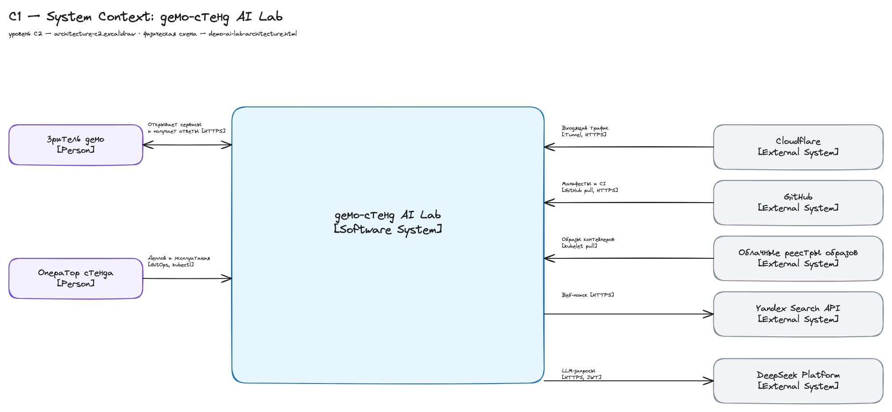
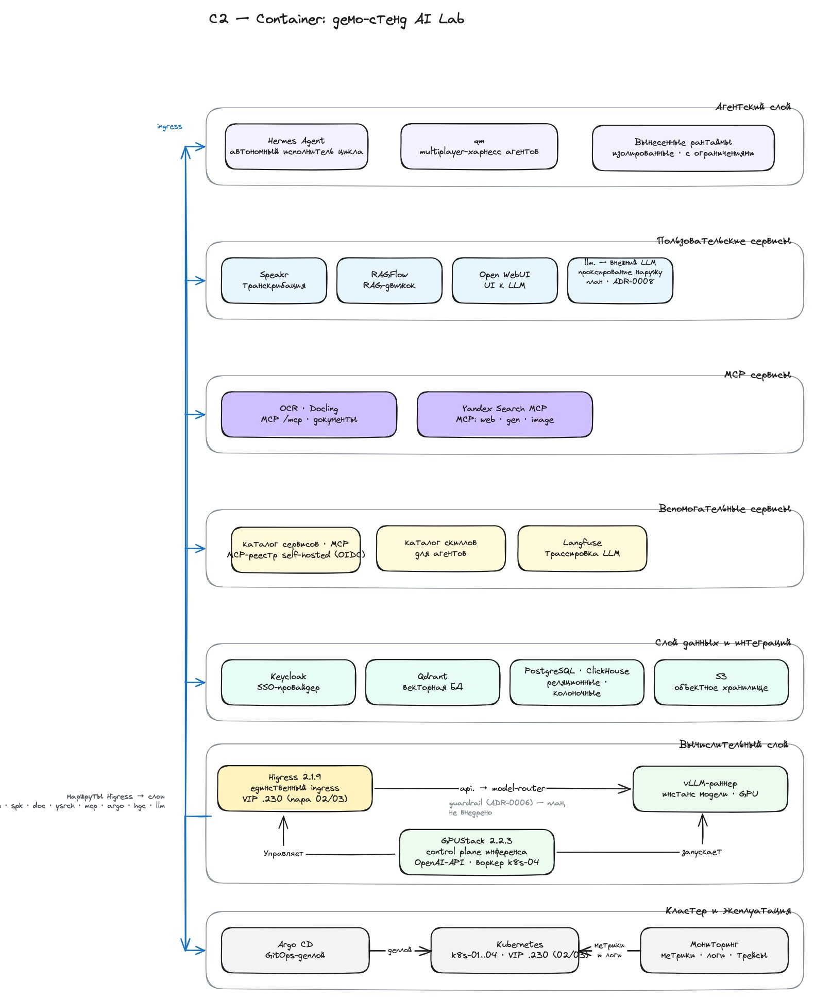
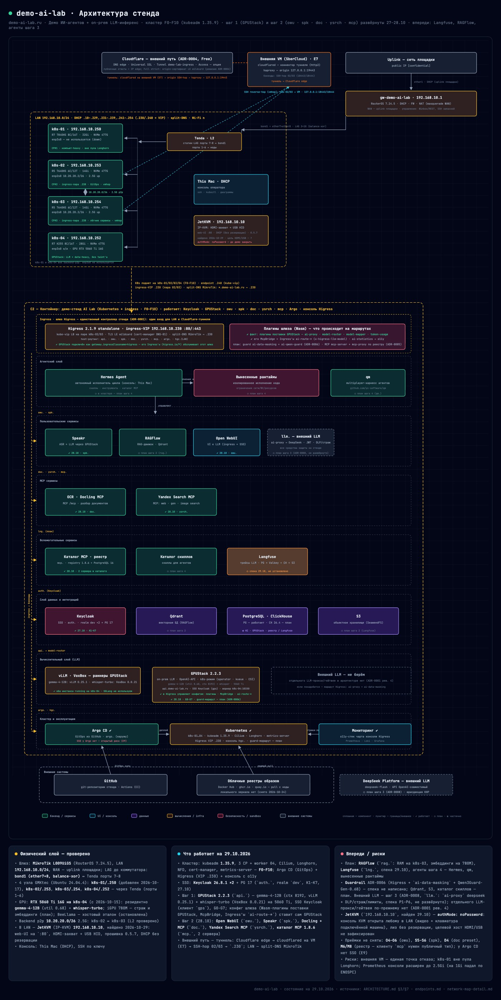

# architecture — архитектура стенда demo-ai-lab

Три уровня, не смешивать:

- **диаграммы** — этот каталог: исходники (`.excalidraw`, `.html`) + рендеры `.jpg`;
- **спецификации сервисов** — `architecture/specs/` (пины, размещение, фазы, приёмка, риски);
- **текущее состояние стенда** — только `architecture/ARCHITECTURE.md` §7 (единственный источник
  статуса: что закрыто, что открыто). Датированные снимки `architecture/hardware-inventory.md` —
  история, не статус.

## Диаграммы

Рендер лежит рядом с источником (единственный формат вывода — `.jpg`); пересборка:

```bash
python3 scripts/render_diagrams.py            # весь каталог
python3 scripts/render_diagrams.py --changed  # только источники новее своего .jpg
```

Нужны node ≥ 18 и Chromium (кэш Playwright или системный Chrome) — `scripts/README.md`.

Рендер проверяет `index` каждого элемента (fractional-index Excalidraw). Битый или
дублирующийся ключ → скрипт падает с id элементов: такой файл приложение не откроет
(«Unable to load initial data»), хотя экспорт в JPEG проходит. Поэтому правки JSON руками
обязаны заканчиваться этим прогоном, а лучше — правкой в самом Excalidraw.

### C1 — контекст



Стенд одним блоком: акторы (зритель, оператор) и внешние системы (Cloudflare, GitHub,
реестры образов, Yandex Search API, **DeepSeek Platform** — план шага 3, ADR-0008).
Исходник — `architecture/architecture-c1.excalidraw`.

### C2 — целевой контейнер



Слои внутри стенда (физический узел, кластер, данные и интеграции, сервисы шагов 1–4);
в полосе «Пользовательские сервисы» — карточка `llm.` (проксирование наружу, план ADR-0008,
внешний провайдер на схеме не рисуется) — исходник слоёв для `architecture/ARCHITECTURE.md`.
Исходник — `architecture/architecture-c2.excalidraw`.

### Полная диаграмма — физический + логический слой



Живая схема стенда: узлы GMKtec и их роли, ingress-VIP `.230` + Higress, внешний путь через
Cloudflare Tunnel, сервисы по шагам демо. Открывается в браузере как интерактив —
`architecture/demo-ai-lab-architecture.html`.

## Спецификации — `architecture/specs/`

| Спека | О чём | Фазы приёмки |
|---|---|---|
| `architecture/specs/k8s-install-spec.md` | установка кластера: kubeadm → Cilium → Longhorn → NFD → cert-manager → Argo CD → ingress-VIP `.230` + Higress; грабли и приёмка каждой фазы | F0–F10 |
| `architecture/specs/external-access-spec.md` | внешний доступ: Cloudflare Tunnel, split-DNS, TLS Full strict, второй egress (коннектор на внешней VM + SSH-hop) | E1–E5, E7 (E6 снят) |
| `architecture/specs/keycloak-spec.md` | SSO: Keycloak 26.8.1 ×2 + PostgreSQL 17.11 на паре k8s-02/03, `auth.demo-ai-lab.ru`, realm `dev` | K1–K7 |
| `architecture/specs/gpustack-spec.md` | шаг 1: GPUStack 2.2.3 — чарт, GPU-воркер на k8s-04, раннер vLLM, модели, `api.demo-ai-lab.ru` | G0–G8 |
| `architecture/specs/owu-spec.md` | Open WebUI (`owu.`): чарт 17.0.0, OIDC через Keycloak, ключ GPUStack, пробы/ресурсы | O1–O6 |
| `architecture/specs/spk-spec.md` | Speakr (`spk.`): plain-манифесты, ASR через GPUStack `openai_whisper`, SSO | S1–S6 |
| `architecture/specs/doc-spec.md` | Docling Serve + **MCP** (`doc.`, `/mcp`): образ `-cpu`, OCR на CPU с русским, кэш моделей Job-хуком | D1–D6 |
| `architecture/specs/ysearch-spec.md` | Yandex Search MCP (`ysrch.`): форк v1.3.1, StreamableHTTP `/mcp`, TCP-пробы | Y1–Y5 |
| `architecture/specs/mcp-registry-spec.md` | каталог MCP-серверов (`mcp.`): Registry 1.8.6 + PostgreSQL 16, витрина на `/`, API `/v0` | M1–M8 |
| `architecture/specs/langfuse-spec.md` | шаг 2: Langfuse (`lng.`) — трейсы LLM-вызовов, свой ClickHouse 26.4 + PostgreSQL 18 + Valkey + SeaweedFS, SSO OIDC | L1–L7 |
| `architecture/specs/llm-proxy-spec.md` | проксирование LLM наружу (`llm.`, ADR-0008): JWT Keycloak `client_credentials`, `jwt-auth` + `opa` по `aud`/роли, `ai-proxy` (deepseek), DLP/страж fail-closed, лимиты; **не развёрнуто** | P1–P6 |

Фазы буквами не переиспользуются между спеками; правила оформления — `references/service-spec-authoring.md`.
Статус каждой спеки (установлено / не установлено, что закрыто) — `architecture/ARCHITECTURE.md` §7.

## Остальное в каталоге

| Файл | Что это |
|---|---|
| `architecture/ARCHITECTURE.md` | архитектура C2 + размещение по узлам + статус строительства (§7) + файлы (§8) |
| `architecture/endpoints.md` | все публичные адреса короткими именами (`owu`, `rag`, `doc`, `spk`, `api`, `auth`, …) и кто за SSO |
| `architecture/hardware-inventory.md` | инвентарь железа: диски и износ (SMART), прошивки, TBW — датированные снимки |
| `architecture/architecture-c1.*`, `architecture/architecture-c2.*`, `architecture/demo-ai-lab-architecture.*` | диаграммы: исходники (`.excalidraw`, `.html`) и рендеры (`.jpg`) |
