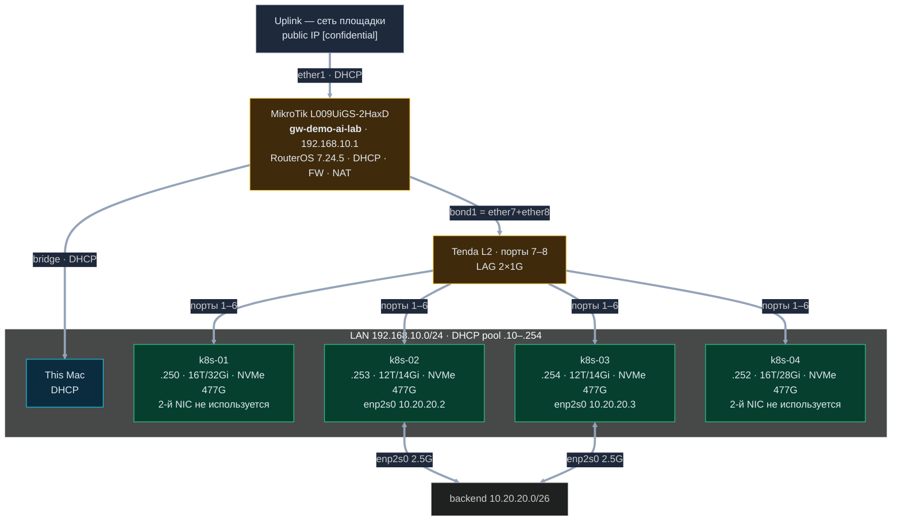

# Карта сети — demo-ai-lab

Актуализировано **2026-10-17** (добавлена нода k8s-01; **переустановлены k8s-02/03** —
разметка root-LV 100G, подготовка containerd/swap сброшена; резервации .253/.254 после
переустановки не матчились из-за нового DUID client-id — восстановлены в тот же день);
база — аудит 2026-10-12:
REST-API MikroTik (`192.168.10.1:8080`), DHCP-leases с роутера, SSH на ноды.
MAC/логины — в `inventory.local.md` (не публикуется).

## Сегменты

| Сегмент | Назначение | Адресация | Статус |
|---|---|---|---|
| `192.168.10.0/24` | LAN: кластер + консоль, DHCP, NAT в интернет | DHCP pool `.10–.254` | живой |
| `10.20.20.0/26` | backend p2p k8s-02↔k8s-03, 2.5G MTU 1500 | статика в netplan | L2 проверен (2026-10-12); ⚠️ 2026-10-17 netplan на 02/03 стёрт переустановкой (`enp2s0` down) — восстановление отложено |

## Узлы кластера

| Хост | IP (LAN, DHCP) | 2-й интерфейс | CPU | RAM | Диск (live-замер) | Роль / состояние |
|---|---|---|---|---|---|---|
| `k8s-01` | 192.168.10.250 | `enp3s0` — **не используется** (down) | 16T (8C, R7 7840HS) | 32Gi (30Gi usable) | NVMe 476.9G · root-LV 100G · ~374G в VG | **добавлена 2026-10-17**; **control-plane #1 + компьют-heavy сервисы (ADR-0003)** · containerd нет, swap ON · Ubuntu 24.04.4 |
| `k8s-02` | 192.168.10.253 | `enp2s0` down (netplan стёрт переустановкой) | 12T (6C, R5 7640HS) | 14Gi | NVMe 477G · root-LV **100G** · ~374G в VG | **control-plane #2** + ingress (Higress, ADR-0001) + GitOps · **переустановлена 2026-10-17**: containerd нет, swap ON · Ubuntu 24.04.4 |
| `k8s-03` | 192.168.10.254 | `enp2s0` down (netplan стёрт переустановкой) | 12T (6C, R5 7640HS) | 14Gi | NVMe 477G · root-LV **100G** · ~374G в VG | **control-plane #3** + лёгкие сервисы · **переустановлен 2026-10-17**: containerd нет, swap ON · Ubuntu 24.04.4 |
| `k8s-04` | 192.168.10.252 | `enp3s0` — **не используется** | 16T (8C, R7 H 255) | 28Gi | NVMe 477G · root-LV 100G · **~374G в VG** | worker: LLM-инференс + сервисы (без taint'а, ADR-0003) · containerd 2.2.1 · swap off · Ubuntu 24.04.4 |
| `This Mac` | DHCP | — | — | — | — | консоль (ssh/kubectl) |

## Ключевые точки

- Шлюз — физический MikroTik `L009UiGS-2HaxD` (`192.168.10.1`, identity `gw-demo-ai-lab`),
  RouterOS 7.24.5. WAN — uplink-сеть площадки (адреса не публикуются); public IP [confidential].

## Проверено / не проверено

**Проверено (живые команды):**
- SSH по ключу на `k8s-01/02/03/04` → `hostname` соответствует, backend-интерфейсы те же.
- Аутентификация на MikroTik подтверждена: REST API (Basic) на порту **8080** (`http://192.168.10.1:8080/rest`), SSH (22, пароль `admin`, ключи не принимаются) и RouterOS API (8728).
- DHCP: pool `.10–.254`; DNS-статик `router.lan`.
- Изоляция: forward drop LAN → uplink-сеть (другие стенды): ping из LAN в uplink молчит, интернет (8.8.8.8) отвечает — проверено 2026-10-12.
- DHCP-лизы нод **зарезервированы по MAC** (make-static, 2026-10-12): k8s-04→.252 держится; k8s-01→.250 (2026-10-17, проверено перегрузкой) держится. **2026-10-17: после переустановки 02/03 их резервации .253/.254 не сработали** (MAC те же, узлы получили динамические .246/.245). Причина: RouterOS матчит lease по **client-id**, Ubuntu 24.04 шлёт DUID, производный от machine-id — переустановка его породила новый, static-запись «ожидала» старый. **Восстановлено в тот же день**: client-id в static-записях обновлён (REST по явному разрешению владельца), лизинги bound, узлы на .253/.254. Консоль — динамический лизинг, её адрес не фиксируем.
- Cloud DDNS отключён: на RouterOS 7.24 `ddns-enabled` принимает только `yes`/`auto`, где `auto` = DDNS живёт только при включённом **Back To Home** (у нас `revoked-and-disabled`). Публичное имя роутера не резолвится (NXDOMAIN у 8.8.8.8 и 1.1.1.1) — проверено 2026-10-12.
- Wi-Fi AP: SSID **HighLoad++Moscow** (2.4GHz-n, wpa2-psk+wpa3-psk). PSK задан 2026-10-12 — значение только в `inventory.local.md`, в публичные доки не публикуется.
- **Link aggregation MikroTik↔Tenda**: bond1 = ether7+ether8, mode `balance-xor` (у Tenda — статическая агрегация портов 7–8, без LACP), bond1 порт бриджа. Проверено: все три ноды пингуются через bond с обеих сторон (роутер → ноды, Mac DHCP → ноды), проверено 2026-10-12.
- **Проброс WAN 80/443 → ingress**: dstnat `tcp 80,443 from WAN → 192.168.10.253` (k8s-02, планируемый ingress — **Higress**, ADR-0001) + forward-accept 80 из WAN (443 — правило «Web 443») — добавлено 2026-10-12 через REST по явному разрешению. **Сквозной доступ заработает после поднятия ingress**; сейчас на .253 порты 80/443 никто не слушает. Для LAN-клиентов (Wi-Fi аудитории) нужен hairpin NAT или DNS-static `api.demo-ai-lab.ru → .253` — отдельный пункт.
- **Диски нод** (2026-10-12, lsblk): физически NVMe 476.9G («AirDisk 512GB SSD») на всех трёх; root-LV: 02/03 — 270G, 04 — 100G. Свободно в VG: ~204G / ~204G / **~374G** (k8s-04). «266G/98G» в старых аудитах = размер root-LV, не диска; заявленный «1 ТБ» не подтверждён. Модель и план — ADR-0002. ⚠️ Снимок устарел: после переустановки 02/03 и добавления 01 root-LV 100G и ~374G VG на всех четырёх (см. таблицу «Узлы кластера»).

**Не проверено (не выдумываю):**
- Внешняя доступность демо-сервисов из интернета (public IP [confidential] — проверял только в облаке роутера).

## Управление

Подключение к нодам (SSH) и к MikroTik — **чтение: REST (8080, основной канал); разовые команды: SSH (22); изменения: Winbox/UI**. Доступ — см. `inventory.local.md` (только у владельца; логины/пароль там, файл не публикуется).
