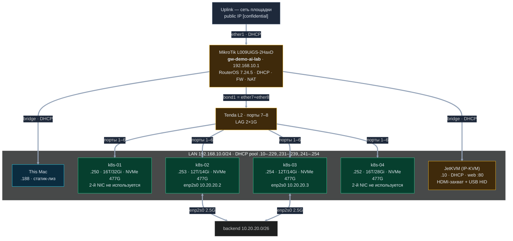

# Карта сети — demo-ai-lab

Актуализировано **2026-10-29** (в LAN обнаружено устройство **JetKVM — IP-KVM `192.168.10.10`**,
раздел «Прочие устройства в LAN»; сеть без изменений — DHCP-лизы `.10/.188/.250/.252/.253/.254`
`bound`, остальные записи прежние).
Ранее — **2026-10-18** (сеть: ingress-VIP `.230` выведен из DHCP-пула, работает split-DNS,
Cloudflare Tunnel — ADR-0004; 2026-10-17: добавлена нода k8s-01, **переустановлены k8s-02/03** —
разметка root-LV 100G, подготовка узлов затем восстановлена прогоном F0; резервации .253/.254 после
переустановки не матчились из-за нового DUID client-id — восстановлены в тот же день);
база — аудит 2026-10-12:
REST-API MikroTik (`192.168.10.1:8080`), DHCP-leases с роутера, SSH на ноды.
MAC/логины — в `inventory.local.md` (не публикуется).

## Сегменты

| Сегмент | Назначение | Адресация | Статус |
|---|---|---|---|
| `192.168.10.0/24` | LAN: кластер + консоль, DHCP, NAT в интернет | DHCP pool `.10–.229,.231–.239,.241–.254` (`.240` — API-VIP, `.230` — ingress-VIP, не выдаются) | живой |
| `10.20.20.0/26` | backend p2p k8s-02↔k8s-03, 2.5G MTU 1500 | статика в netplan | L2 проверен (2026-10-12); netplan восстановлен 2026-10-18 (`ansible/pb-net-p2p.yaml`, взаимный ping) |

## Узлы кластера

| Хост | IP (LAN, DHCP) | 2-й интерфейс | CPU | RAM | Диск (live-замер) | Роль / состояние |
|---|---|---|---|---|---|---|
| `k8s-01` | 192.168.10.250 | `enp3s0` — **не используется** (down) | 16T (8C, R7 7840HS) | 32Gi (30Gi usable) | NVMe 476.9G · root-LV 100G · ~374G в VG | **добавлена 2026-10-17**; **control-plane #1 + компьют-heavy сервисы (ADR-0003)** · F0 выполнен 2026-10-17 (containerd 2.2.1+CRI, swap off) · Ubuntu 24.04.4 |
| `k8s-02` | 192.168.10.253 | `enp2s0` p2p `10.20.20.2` (восстановлен 2026-10-18) | 12T (6C, R5 7640HS) | 14Gi | NVMe 477G · root-LV **100G** · ~374G в VG | **control-plane #2** + **ingress-пара с 03 (Higress, VIP .230; ADR-0001)** + GitOps + cloudflared · **переустановлена 2026-10-17**: F0 выполнен 2026-10-17 (containerd 2.2.1+CRI, swap off) · Ubuntu 24.04.4 |
| `k8s-03` | 192.168.10.254 | `enp2s0` p2p `10.20.20.3` (восстановлен 2026-10-18) | 12T (6C, R5 7640HS) | 14Gi | NVMe 477G · root-LV **100G** · ~374G в VG | **control-plane #3** + **ingress-пара с 02 (VIP .230)** + cloudflared + лёгкие сервисы · **переустановлен 2026-10-17**: F0 выполнен 2026-10-17 (containerd 2.2.1+CRI, swap off) · Ubuntu 24.04.4 |
| `k8s-04` | 192.168.10.252 | `enp3s0` — **не используется** | 16T (8C, R7 H 255) | 28Gi | NVMe 477G · root-LV 100G · **~374G в VG** | worker: LLM-инференс + сервисы (без taint'а, ADR-0003) · containerd 2.2.1 · swap off · Ubuntu 24.04.4 |
| `This Mac` | 192.168.10.188 (статик-лиз в пуле) | — | — | — | — | консоль (ssh/kubectl) |

## Прочие устройства в LAN

| Хост | IP (LAN, DHCP) | Что это | Порты | Состояние |
|---|---|---|---|---|
| `jetkvm-<deviceId>` | 192.168.10.10 | **JetKVM** — IP-KVM (KVM-over-IP: HDMI-захват + USB HID, управление из браузера); производитель — BuildJet | **только TCP 80** (HTTP; SSH и прочих слушателей нет) | найдено 2026-10-29: лиз DHCP `bound` из пула, приёмка/пароль не настроены, к JetKVM Cloud не подключён |

**JetKVM `192.168.10.10` — что снято живьём (2026-10-29):**

- Web-UI: `http://192.168.10.10/` — SPA «JetKVM» (SPA отдаёт 200 на любой путь; это не отдельные
  сервисы). API устройства: `GET /device` → `{"authMode":"noPassword","deviceId":"<12 hex>","loopbackOnly":false}`;
  `GET /device/status` → `{"isSetup":true}`; `GET /metrics` — Prometheus (22,5 КБ, счётчики соединений + NTP).
- Прошивка **0.5.7** (`branch=dev`, `go1.25.1`, `linux/arm` — из метрики `jetkvm_build_info`).
- Сеть: DHCP-имя вида `jetkvm-<deviceId>` (тот же идентификатор, что в `/device`); лиз из общего пула, **резервации нет** —
  адрес `.10` может уехать на другое устройство; mDNS/SSDP не анонсирует, DHCP-опций для discovery нет.
- Cloud-канал: `jetkvm_cloud_connection_status 0` (к JetKVM Cloud не подключён), время синхронизировано.
- **`authMode: noPassword`** — консоль открывается без пароля любому в LAN, а за ней реальные
  видео и клавиатура подключённой машины. Это доступ уровня «руки на железе»: до демо поставить
  пароль в UI (Settings → Access) и, если нужно, ограничить `:80` правилом на MikroTik.
- Целевой хост (к какой машине подключены HDMI/USB) по сети не определяется — фиксировать вручную
  в этой таблице, когда станет известно.

## Ключевые точки

- Шлюз — физический MikroTik `L009UiGS-2HaxD` (`192.168.10.1`, identity `gw-demo-ai-lab`),
  RouterOS 7.24.5. WAN — uplink-сеть площадки (адреса не публикуются); public IP [confidential].

## Проверено

**Проверено (живые команды):**
- SSH по ключу на `k8s-01/02/03/04` → `hostname` соответствует, backend-интерфейсы те же.
- Аутентификация на MikroTik подтверждена: REST API (Basic) на порту **8080** (`http://192.168.10.1:8080/rest`), SSH (22, вход `admin` по паролю, ключи не принимаются) и RouterOS API (8728).
  Значение пароля в репозитории не публикуется — только в `inventory.local.md` (вне git).
- DHCP: pool `.10–.254` (состояние аудита 2026-10-12); с 2026-10-18 — `.10–.229,.231–.239,.241–.254`
  (`.240` API-VIP и `.230` ingress-VIP не выдаются). DNS-статик `router.lan`.
- Изоляция: forward drop LAN → uplink-сеть (другие стенды): ping из LAN в uplink молчит, интернет (8.8.8.8) отвечает — проверено 2026-10-12.
- DHCP-лизы **зарезервированы**: четыре ноды bound (.250/.253/.254/.252) + консоль `.188`
  (статик-лиз, адрес лежит внутри пула — его держит сам лиз; из пула выводят только VIP `.230/.240`,
  у которых MAC нет). Грабля переустановок (RouterOS матчит lease по client-id/DUID) и лечение —
  `mikrotik-setup.md` §3.5.
- **2026-10-29 — новое устройство в LAN: JetKVM `.10`** (IP-KVM: HDMI-захват + USB HID, web-UI на
  `:80`, прошивка 0.5.7). Лиз `bound` из общего пула, **резервации нет**; скан портов — открыт только
  TCP 80, SSH нет; MAC по `arp` — из блока производителя JetKVM. Паспорт устройства —
  §«Прочие устройства в LAN» (MAC/`deviceId` — в `inventory.local.md`).
- Cloud DDNS отключён, публичное имя роутера не резолвится (NXDOMAIN у 8.8.8.8/1.1.1.1, проверено 2026-10-12); квирки RouterOS 7.24 — `mikrotik-setup.md` §3.10.
- Wi-Fi AP: SSID **HighLoad++Moscow** (2.4GHz-n, wpa2-psk+wpa3-psk). PSK задан 2026-10-12 — значение только в `inventory.local.md`, в публичные доки не публикуется.
- **Link aggregation MikroTik↔Tenda**: bond1 = ether7+ether8, mode `balance-xor` (у Tenda — статическая агрегация портов 7–8, без LACP), bond1 порт бриджа. Проверено: все три ноды пингуются через bond с обеих сторон (роутер → ноды, Mac DHCP → ноды), проверено 2026-10-12.
- **Маршрутизация сервисов — через ingress-VIP `.230` и Higress** (пара k8s-02+k8s-03, VIP отдельный от API-`.240`): снаружи — Cloudflare Tunnel (ADR-0004), с 2026-10-19 на `https://.230` (Full strict); из LAN — split-DNS на тот же VIP. Проброс WAN 80/443 → `.253` (2026-10-12) **отключён** (disabled, 2026-10-19).
- **split-DNS работает (2026-10-18)**: `demo-ai-lab.ru` + regexp-wildcard `(.*)\.demo-ai-lab\.ru` → `.230` на MikroTik — LAN/Wi-Fi аудитория резолвит напрямую, минуя WAN (рецепт: `mikrotik-setup.md` §3.5).
- **AAAA закрыт (2026-10-27)**: тот же split-DNS отдаёт для зоны `AAAA = ::1` (apex + regexp-wildcard); до правки AAAA уходил в публичный резолвер и возвращал anycast Cloudflare (`2606:4700:…`), из-за чего клиенты с IPv6-предпочтением уходили из LAN наружу, минуя `.230`. Проверка: `dig @192.168.10.1 owu.demo-ai-lab.ru AAAA` → `::1`.
- Диски нод: актуальная разметка — таблица «Узлы кластера» выше; хронология замеров и разбор старых цифр — `architecture/hardware-inventory.md`, модель — ADR-0002.

**Плюс приборный замер 2026-10-24 (`scripts/k8s_health.py` + Cloudflare API):**
- Внешний путь сквозной: **200 на 4/4 запросах** через edge; origin `https://192.168.10.230`
  отвечает 200 с сертификатом Let's Encrypt (issuer YR1), внутри `server: istio-envoy`.
- Туннель в Cloudflare API — `demo-lab-ingress-v2`; коннектор на внешней VM (SberCloud),
  4 соединения healthy без ротаций; origin доводится SSH-hop → haproxy → `https://127.0.0.1:19443` (E7).
- `cloudflared` на k8s-02/03 выведен (`disable --now`, E7); на k8s-01 — inactive (коннекторов там нет).
- Держатели VIP на момент замера: `.240` (API) — k8s-03, `.230` (ingress) — k8s-02; держатель
  меняется при отказе, адреса не привязаны к узлам.

## Управление

Подключение к нодам (SSH) и к MikroTik — **чтение: REST (8080, основной канал); разовые команды: SSH (22); изменения: Winbox/UI**. Доступ — см. `inventory.local.md` (только у владельца; логины/пароль там, файл не публикуется).
