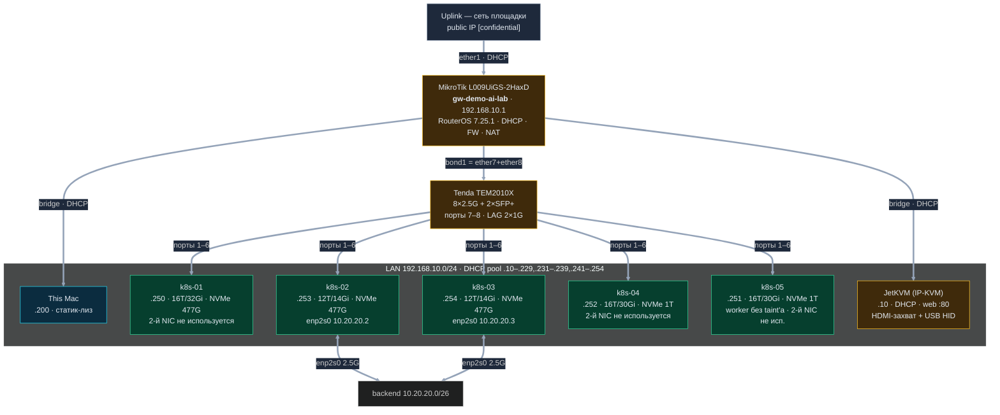

# Карта сети — demo-ai-lab

Актуализировано **2026-11-08**, сверено с живым стендом **2026-11-19** (REST MikroTik + DHCP-лизы,
SSH на ноды). MAC-адреса и логины здесь не публикуются — они в `inventory.local.md` (gitignored).
Рецепт роутера — `network/mikrotik.md`, железо нод — `architecture/hardware-inventory.md`.

## Сегменты

| Сегмент | Назначение | Адресация | Статус |
|---|---|---|---|
| `192.168.10.0/24` | LAN: кластер + консоль, DHCP, NAT в интернет | DHCP pool `.10–.229,.231–.239,.241–.254` (`.240` — API-VIP, `.230` — ingress-VIP, не выдаются) | живой |
| `10.20.20.0/26` | backend p2p k8s-02↔k8s-03, 2.5G MTU 1500 | статика в netplan | L2 проверен (2026-10-12); netplan восстановлен 2026-10-18 (`ansible/pb-net-p2p.yaml`, взаимный ping) |

## Узлы кластера

Только сетевое. Ресурсы, диски и состояние узлов — `architecture/hardware-inventory.md`; роли и
размещение сервисов — `architecture/ARCHITECTURE.md` §2.3, §5.

| Хост | IP (LAN) | 2-й интерфейс | Роль в сети |
|---|---|---|---|
| `k8s-01` | 192.168.10.250 | `enp3s0` — не используется (down) | control-plane; участник kube-vip (API-VIP `.240`) |
| `k8s-02` | 192.168.10.253 | `enp2s0` — p2p `10.20.20.2` | control-plane; kube-vip; **ingress-пара, VIP `.230`** + vmhop |
| `k8s-03` | 192.168.10.254 | `enp2s0` — p2p `10.20.20.3` | control-plane; kube-vip; **ingress-пара, VIP `.230`** + vmhop |
| `k8s-04` | 192.168.10.252 | `enp3s0` — не используется | worker, сетевой роли нет |
| `k8s-05` | 192.168.10.251 | `enp2s0` — не используется (down) | worker, сетевой роли нет |
| `This Mac` | 192.168.10.200 (статик-лиз) | — | консоль: ssh, kubectl |

## Прочие устройства в LAN

| Хост | IP (LAN, DHCP) | Что это | Порты | Состояние |
|---|---|---|---|---|
| `jetkvm-<deviceId>` | 192.168.10.10 | **JetKVM** — IP-KVM (KVM-over-IP: HDMI-захват + USB HID, управление из браузера); производитель — BuildJet | **только TCP 80** (HTTP; SSH и прочих слушателей нет) | найдено 2026-10-29: лиз DHCP `bound` из пула, приёмка/пароль не настроены, к JetKVM Cloud не подключён; **подключён к k8s-04** (2026-11-17), питается от USB ноды |

## Ключевые точки

- Шлюз — MikroTik `L009UiGS-2HaxD` (`192.168.10.1`, identity `gw-demo-ai-lab`), RouterOS **7.25.1**.
  WAN — uplink-сеть площадки (адреса не публикуются); public IP [confidential].
- **VIP** (вне DHCP-пула, держит kube-vip через ARP): `.240` — API кластера (control-plane 01/02/03),
  `.230` — ingress Higress (пара 02/03). Клиенты LAN ходят на сервисы по имени: split-DNS на
  роутере отдаёт `demo-ai-lab.ru` и `*.demo-ai-lab.ru` → `.230`, AAAA → `::1` (IPv6 на стенде нет).
- **Изоляция:** из LAN в сеть площадки трафик закрыт (`drop` в `forward`); исключение — ответы
  проброса WAN→`.230` (`connection-nat-state=dstnat`). Наружу стенд публикуется через внешнюю VM:
  `haproxy :443` (TLS passthrough, SNI) → SSH-hop 02/03 → `.230` → Higress (ADR-0004, рев. 2026-11-05);
  рецепт правил — `network/mikrotik.md` §3.6–3.7.
- **Wi-Fi:** встроенный AP `wifi1` в бридже, 2.4 GHz, SSID `7llm-cases-hl++` (wpa2-psk+wpa3-psk;
  PSK — в `inventory.local.md`).

## Управление

Подключение к нодам (SSH) и к MikroTik — **чтение: REST (8080, основной канал); разовые команды: SSH (22); изменения: Winbox/UI**. Доступ — см. `inventory.local.md` (только у владельца; логины/пароль там, файл не публикуется).
